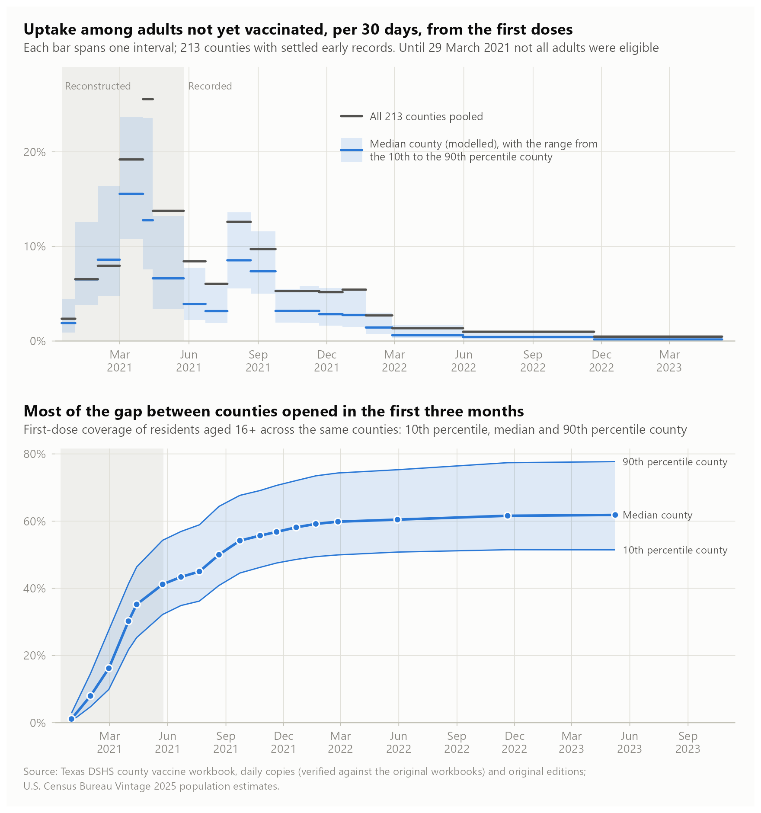
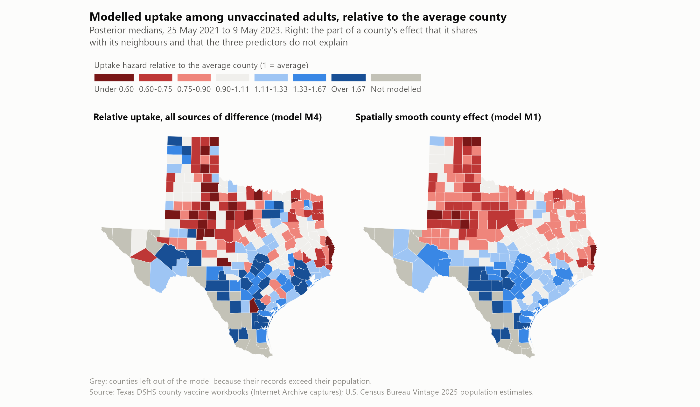
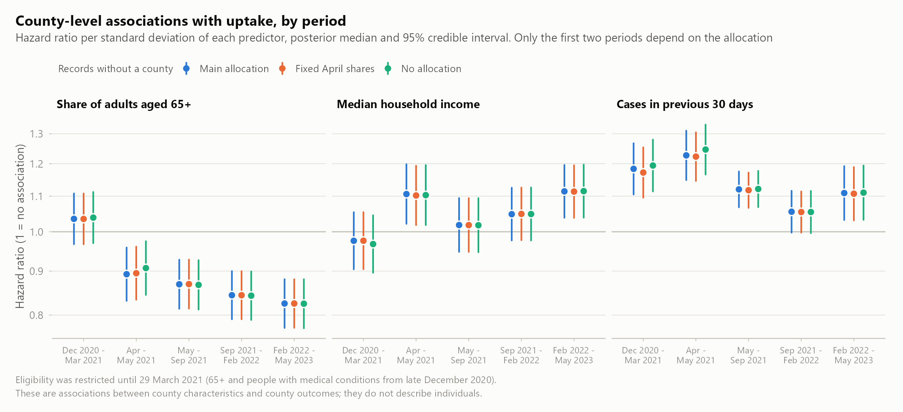

# COVID-19 vaccination coverage across Texas counties, December 2020 to May 2023

**Summary report.** A county-level study of first-dose COVID-19 vaccination among Texas residents aged 16 and over,
built from archived Texas Department of State Health Services (DSHS) records and analysed with a Bayesian
spatiotemporal model. This is the short version; the documents listed at the end hold the detail. Every number
below is filled in from the same result files as those documents. Built 24 November 2026.

Three words have a fixed meaning throughout. **Recorded** is a count from the DSHS registry divided by a Census
population estimate. **Reconstructed** applies before 24 May 2021: the published county count plus the county's
allocated share of the recipients who had no county on record, which rests on a stated assumption. **Modelled** is
a summary from the statistical model, given with a 95% credible interval. All three describe vaccine receipt as
recorded. None measures willingness to be vaccinated.

## Main findings

1. **Coverage rose, and the gaps between counties widened.** Recorded statewide coverage went from
   52.5% on 24 May 2021 to 82.3% on 9 May 2023. Among the 238 counties that
   could be modelled, the median county went from 41.3% to 61.9%, and the distance between
   the 90th- and 10th-percentile county grew from 21.7 to 26.2 percentage points. County
   ranks barely moved over those two years (rank correlation 0.90).
2. **Most of that gap opened in the first three months of the rollout.** Across the 213 counties with
   usable early records, the reconstructed gap was 9.9 points at the end of January 2021,
   17.6 at the end of February and 22.1 on 24 May 2021. By the end of February it had already
   reached 67% of its final size (26.3 points on 9 May 2023). Which counties were
   ahead was not yet settled then: county coverage at the end of February has a rank correlation of
   0.37 with coverage in May 2023, against 0.90 for coverage on 24 May 2021. The lasting
   order was set in the spring of 2021, when eligibility opened to all adults (Figure 1, bottom).
3. **Uptake was fastest in early April 2021.** Statewide, 26.5% of adults not yet vaccinated received
   a first dose per 30 days in the first two weeks of April 2021, just after eligibility opened to all adults.
   After 24 May 2021 the rate, pooled over the 238 modelled counties, fell to 6.0% in early
   summer, rose to 12.6% during the Delta wave (22 July to 21 August 2021), and was at or below 1% from
   June 2022 (Figure 1, top).
4. **Counties differed about threefold in uptake, in a clear geographic pattern.** Between 25 May 2021 and 9 May
   2023 the modelled uptake rate in the 90th-percentile county was 3.0 times that in the
   10th-percentile county. Rates were lowest in the Panhandle, the Rolling Plains and deep East Texas, and highest
   in the large metropolitan counties and South Texas (Figure 2). Counties that were ahead in May 2021 went on
   vaccinating their remaining unvaccinated adults faster: 1.49 times faster for each 10 points of
   starting coverage (95% confidence interval 1.42 to 1.56). That is why the gap kept widening.
5. **Counties with more older adults fell behind once all adults were eligible.** While eligibility was restricted
   (to 31 March 2021), counties with a larger share of adults aged 65+ had similar or slightly higher uptake: the
   hazard ratio per standard deviation of that share (6.2 points) was 1.04 (0.97 to 1.11). In April
   and May 2021 it was 0.89 (0.83 to 0.96), and over the two years from 25 May 2021 it was 0.83 (0.78 to 0.88)
   (Figure 3).
6. **Recent cases went with higher uptake; income only weakly.** Counties with more reported cases in the previous
   30 days had higher uptake in every period: the hazard ratio per standard deviation (a 4.0-fold
   difference in the case rate) was 1.06 (1.03 to 1.09) after May 2021, and 1.18 (1.11 to 1.27) and
   1.23 (1.15 to 1.31) in the two earlier periods. Median household income was associated with the coverage a
   county had reached by May 2021 (odds ratio 1.05 (1.01 to 1.10) per standard deviation, a 27% difference in
   income). Its association with later uptake, 1.05 (0.98 to 1.13), is an interval that includes no association.

Findings 4 to 6 are associations between county characteristics and county outcomes. They do not describe
individuals, and they do not show why uptake differed.

*Figure 1. Uptake among adults not yet vaccinated (top) and the spread of coverage across counties (bottom), from
the first doses to May 2023. The shaded months before 24 May 2021 are reconstructed.*

*Figure 2. Modelled uptake relative to the average county, 25 May 2021 to 9 May 2023. Left: all sources of
difference. Right: the part of a county's effect that it shares with its neighbours and that the three predictors
do not explain.*

*Figure 3. Hazard ratios per standard deviation of each county characteristic, by period. The three colours are
three ways of handling the early records that had no county; they agree.*

## Key numbers

Recorded first-dose coverage of residents aged 16 and over.

|   | 24 May 2021 | 9 May 2023 |
|---|---|---|
| Statewide (all 254 counties) | 52.5% | 82.3% |
| The 238 modelled counties together | 50.9% | 77.2% |
| Median county | 41.3% | 61.9% |
| 10th-percentile county | 32.2% | 51.3% |
| 90th-percentile county | 54.0% | 77.6% |
| Gap between the 90th- and 10th-percentile county (points) | 21.7 | 26.2 |
| Standard deviation across counties (points) | 8.4 | 10.8 |

## What was analysed

- **Outcome.** Residents aged 16 and over recorded with at least one dose, by county of residence. The source is
  the DSHS "COVID-19 Vaccine Data by County" workbook: 40 usable editions recovered from the Internet Archive, and
  verified daily copies of its county sheet for the early months.
- **Coverage** is that count divided by the Census Bureau (Vintage 2025) estimate of residents aged 16 and over on
  1 July 2021. **Uptake** is the share of adults not yet vaccinated at the start of an interval who received a
  first dose during it, scaled to 30 days so that intervals of different length compare.
- **Period.** The main analysis runs from 24 May 2021 to 9 May 2023 in 12 intervals between surviving editions. An
  extension adds six reconstructed intervals back to 14 December 2020.
- **Counties.** All 254 are described. 238 are modelled.
- **Model.** A binomial model for first doses among adults not yet vaccinated, with a time effect shared by all
  counties, a county effect that borrows strength from neighbouring counties (BYM2), a trajectory of its own for
  each county, and three predictors: the share of adults aged 65+, median household income, and cases reported in
  the previous 30 days. It was fitted with R-INLA. Five versions of the model were compared.

## How the study differs from the proposal

The proposal asked for adults aged 18 and over, calendar months, and a study period chosen from the data. Checking
the sources forced four changes.

| Proposed | Used | Why |
|---|---|---|
| Adults 18+ | Adults 16+ | DSHS county age bands start at 16. The only 18+ county counts are in a CDC file that has no Texas county data before 22 October 2021 and disagrees with DSHS. |
| Calendar months | Intervals between surviving DSHS editions: 26 to 35 days until February 2022, then 94, 174 and 170 days. Uptake is reported per 30 days. | DSHS overwrote one workbook each day; editions survive only on the dates the Internet Archive captured them. |
| The whole rollout in one analysis | Main analysis from 24 May 2021; the first five months reconstructed separately | Until 15 April 2021, 5% to 11% of recipients had no county on record, by a different amount in each county. |
| 254 counties | 238 modelled; 16 shown but not modelled | In those 16 the recorded number of vaccinated adults exceeds the adult population, so the records cannot be read as coverage of residents. Most are along the Mexican border. |

## How far the results can be trusted

- **Prediction checks.** Each model was refitted with part of the data withheld and scored on what it had not
  seen. Spatial structure lowered the prediction error for counties with no data by 14% when random
  counties were withheld and by 13% when whole regions were. County-specific trajectories lowered the
  error for a county's next interval by 8%, but made predictions for counties with no data
  8% worse. No model forecast the statewide level of the next interval well.
- **Smoothing does not hide local differences.** For 136 of 238 counties the county effect
  differs from its neighbours' with 95% posterior probability. A prediction from neighbours and predictors alone
  would miss a county's May 2023 coverage by 3.6 points on average.
- **Other reasonable choices give the same directions.** Across 12 alternative analyses (other interval
  grids, denominators, sets of counties and definitions of the predictors, and a second approximation method) the
  hazard ratio stays within 0.77 to 0.88 for the 65+ share and 1.03 to 1.08 for recent cases. For income it
  ranges from 1.00 to 1.10: the data do not settle whether income is associated with later uptake.
- **The first five months rest on an assumption.** On 15 April 2021 DSHS assigned about 664,000
  previously unassigned recipients to counties in a single edition. The reconstruction assumes each county was
  missing the same relative share of its recipients at earlier dates. A prediction that follows from this holds
  well for large counties (correlation 0.97 with counties weighted by size) and less well for small
  ones (0.46 with counties weighted equally). With no allocation at all, the gap between counties
  differs by at most 0.7 points and county ranks are almost unchanged (rank correlation at least
  0.97), but the coverage of individual counties moves by up to 8.5 points.

## Limitations

- **16 counties and 8.8% of adults are outside the models**, including El Paso,
  Hidalgo, Cameron and Webb. Conclusions about gaps and associations are about the other 238 counties.
- **Recorded coverage is a complete count, not a sample.** Its uncertainty comes from the records and the
  population estimates, and the credible intervals do not cover it. Uptake rates in counties with high coverage
  are the least reliable numbers, because a small error in the population estimate is a large error in the number
  of adults left.
- **Dates are reporting dates**, intervals are unequal, and three are long. Month-level detail after February 2022
  cannot be recovered from the surviving files.
- **Counties with a prison, military base or university** may show lower recorded coverage for reasons other than
  uptake, because residents' doses can be recorded elsewhere.
- **Three predictors only.** Age composition and income go together with rurality, access to health care,
  political preference and ethnic composition, none of which is in the model.
- **Approximate inference.** R-INLA approximates the posterior. A second approximation gave the same estimates, but
  no simulation-based (MCMC) fit was run to confirm them.
- **Refitting does not give identical numbers.** R-INLA does not return exactly the same fit twice. When the models
  were fitted again, no hazard ratio moved by more than 0.0006, and 21 of the
  510 values compared came out differently, each by at most 5 units in its last
  printed digit. The prediction checks were not run again, so their scores were not compared.

## Where to find everything

These are files in the project folder; the paths start there. This summary is built by
[R/17_summary_report.R](../R/17_summary_report.R) from [docs/00_summary_template.md](00_summary_template.md) and the
tables in `outputs/tables/`.

| | |
|---|---|
| [docs/02_report.md](02_report.md) | Full report: methods, results, model comparison, sensitivity analyses, limitations |
| [docs/01_source_inventory.md](01_source_inventory.md) | Every source, what was verified in it, and the reasons for each change from the proposal |
| [docs/03_early_rollout.md](03_early_rollout.md) | The extension back to December 2020: the allocation, its tests, and what depends on it |
| [site/index.html](../site/index.html) | Interactive version: county map through time, county comparison, charts |
| [README.md](../README.md) | Project layout, the commands that reproduce every step, and how to trace a number to its source file |
| [outputs/tables/county_results.csv](../outputs/tables/county_results.csv) | One row per county: recorded coverage, change, modelled relative uptake with intervals |
