# Bayesian spatiotemporal small-area analysis of COVID-19 vaccination coverage across Texas counties

Results report. The companion document, [01_source_inventory.md](01_source_inventory.md), lists every source, what
was verified in it, and why the age group, time intervals and study period differ from the original proposal.

Throughout, **recorded** means a number taken from Texas DSHS records and a Census population estimate, and
**modelled** means a posterior summary from the Bayesian model. Both describe vaccine receipt as recorded in the
state registry. Neither measures willingness or acceptance.

## 1. Summary

**What could be studied.** The records support first-dose coverage of residents aged 16 and over (not 18 and over),
for 254 counties, from 24 May 2021 to 9 May 2023, at the dates on which original DSHS workbooks survive. County
counts before mid-April 2021 are incomplete in a county-specific way, so the first five months of the rollout enter
only as the coverage each county had reached by 24 May 2021. Sixteen counties, most of them along the Mexican
border, have more recorded vaccinated adults than adult residents; they are shown but not modelled. A separate
extension, [03_early_rollout.md](03_early_rollout.md), reconstructs county coverage back to December 2020 under an
explicit assumption about the recipients who had no county on record; it is kept apart because nothing in this
report rests on that assumption.

**Recorded coverage.**

- Statewide, recorded 16+ first-dose coverage rose from 52.5% on 24 May 2021 to 82.3% on 9 May 2023. In the 238
  counties whose records can be read as resident coverage it rose from 50.9% to 77.2%.
- The median county went from 41.3% to 61.9%, a gain of 20.6 percentage points.
- **The gaps between counties widened.** The distance between the 90th- and 10th-percentile county grew from 21.7 to
  26.2 points, and the standard deviation across counties from 8.4 to 10.8 points. Counties that were ahead in May
  2021 gained more afterwards: each extra point of starting coverage went with 0.18 more points of later gain (95%
  confidence interval 0.11 to 0.24).
- County ranks barely moved (rank correlation between start and end 0.90); 71% of the counties in the lowest fifth in
  May 2021 were still there in May 2023.

**Modelled uptake among adults not yet vaccinated.**

- Pooled over the 238 counties, 8.4% of still-unvaccinated adults received a first dose per 30 days in the
  first interval (25 May to 22 June 2021). The rate peaked at 12.6% during the Delta wave (22 July to 21
  August 2021), stayed near 5% through January 2022, and was at or below 1% from June 2022. The median county was always
  below the pooled rate (3.9% and 8.6% in the same two intervals) because the most populous
  counties vaccinated faster.
- Uptake differed widely between counties: the rate in the 90th-percentile county was 3.0 times that in
  the 10th-percentile county. Rates were lowest in the Panhandle, the Rolling Plains and deep East Texas, and
  highest in the large metropolitan counties and South Texas. Counties with higher coverage in May 2021 also had
  higher uptake among their remaining unvaccinated adults afterwards (1.49 times higher per 10 points
  of starting coverage, 95% confidence interval 1.42 to 1.56), which is why the gaps widened.
- Counties with a larger share of older adults had lower later uptake (hazard ratio 0.83 (0.78 to 0.88) per
  6.2 points of the 65+ share). Counties with more reported cases in the previous 30 days had higher
  uptake (1.06 (1.03 to 1.09) per 4.0-fold higher case rate). Household income was positively associated
  with coverage reached by May 2021 (odds ratio 1.05 (1.01 to 1.10) per 27% higher income); its association
  with later uptake is 1.05 (0.98 to 1.13), an interval that includes no association.

**Model checks.**

- Spatial structure lowered the prediction error for counties with no data by 14% when random counties
  were withheld and by 13% when whole regions were, compared with the same model without it.
- Letting each county follow its own course over time (a mean-reverting process, model M4) lowered the error for a
  county's next interval by 8% and made the uncertainty intervals for later intervals better
  calibrated. It did not reduce the average error further ahead, and it made predictions for counties with no data
  8% worse. No model was best at everything, so the report uses M4 for modelled uptake and the plain
  spatial model (M1) for statements about spatial structure. County results differ little between the two (median
  0.5%).
- No model forecast the statewide level of the next interval well: forecasts for the two intervals after the
  Delta-wave peak and for the Omicron wave were 1.5 to 5 points per 30 days too high.
- Modelled uptake reproduces recorded uptake except in very small counties (median difference 0.002 points
  per 30 days in counties with more than 50,000 adults, 0.16 points below 5,000 adults). For
  136 of 238 counties the county effect differs from its neighbours' with 95% posterior
  probability, so local differences are kept. A prediction from neighbours and predictors alone would miss a
  county's May 2023 coverage by 3.6 points on average.

**Main cautions.** Recorded coverage is a complete count, not a sample, so its uncertainty comes from the records
and the population estimates, not from sampling, and the credible intervals do not cover it. Uptake among "adults
not yet vaccinated" depends on a population estimate; where recorded coverage is high, a small error in that
estimate is a large error in the number of people left. Associations are between county characteristics and county
outcomes and say nothing about individuals.

## 2. What was analysed

| | |
|---|---|
| Outcome | Residents aged 16+ recorded with at least one COVID-19 vaccine dose, by county of residence |
| Source | "By County, Age" sheet of original Texas DSHS "COVID-19 Vaccine Data by County" workbooks, recovered from the Internet Archive (40 usable editions) |
| Recorded coverage | Count divided by the Census Bureau (Vintage 2025) estimate of residents aged 16+ on 1 July 2021 |
| Uptake in an interval | Adults newly recorded with a first dose, divided by adults not yet recorded as vaccinated at the start of the interval; reported per 30 days |
| Time grid | Baseline 24 May 2021, then 12 intervals to 9 May 2023: nine of 26 to 35 days (to 25 February 2022), then 94, 174 and 170 days |
| Counties | 254 described; 238 in the models |
| Predictors | Share of adults aged 65+ (Census estimates, 2021); median household income (ACS 2019-2023); confirmed plus probable COVID-19 cases reported in the 30 days before each interval, per 100,000 residents (DSHS) |
| Neighbours | Census county adjacency: 724 neighbouring pairs |

The proposal asked for adults 18+, calendar months, and a study period chosen from the verified overlap. The
inventory explains each change. In brief: the only 18+ county counts are in a CDC file that has no Texas data
before 22 October 2021 and disagrees with DSHS by up to 36% in individual counties; DSHS's own age bands start at
16; and its workbooks survive only on the dates the Internet Archive captured them.

## 3. Recorded coverage

### 3.1 The rollout before the baseline

Statewide, the rollout before the baseline can be described by month from the last DSHS edition's count of first
doses by date of vaccination. Everyone vaccinated in these months was 16 or older.

| Month of vaccination | First doses | Texans 16+ with a first dose at month end (%) | Uptake among those not yet vaccinated, per 30 days (%) | Coverage the state reported at the time (%) |
|---|---|---|---|---|
| December 2020 | 514,176 | 2.2 | 3.7 | 1.5 |
| January 2021 | 1,827,899 | 10.2 | 7.9 |  |
| February 2021 | 1,703,270 | 17.5 | 8.8 | 15.5 |
| March 2021 | 4,360,448 | 36.5 | 22.3 | 32.9 |
| April 2021 | 3,194,801 | 50.3 | 21.8 | 48.1 |

Uptake among adults not yet vaccinated was 8-9% per 30 days in January and February 2021 and about 22% in March and
April, as supply grew and eligibility widened (to everyone aged 16 and over from 29 March). The last column shows
reporting lag: what the state had published by the first day of the following month was 0.8 to 3.5 points below
what was eventually attributed to the month (no edition survives for 1 February 2021).

By county, no such description is possible without an assumption. Until the edition of 15 April 2021, 5-11% of
recipients had no county on record, and the correction added 1% to Harris County's count but 19% to Tarrant's and
25% to Denton's (Figure 1). The extension [03_early_rollout.md](03_early_rollout.md) makes the assumption explicit
and follows the counties from the first doses.

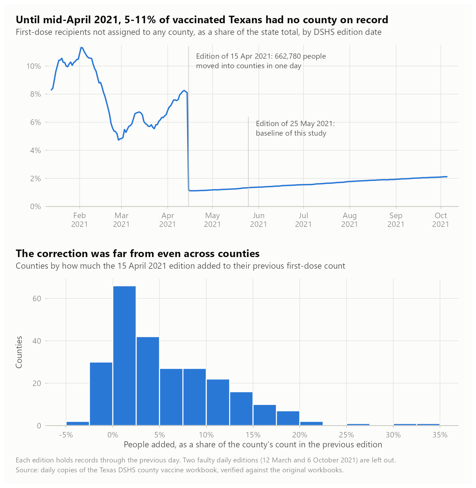

*Figure 1. First-dose recipients without a county, and how unevenly the April 2021 correction fell.*

### 3.2 County coverage and change

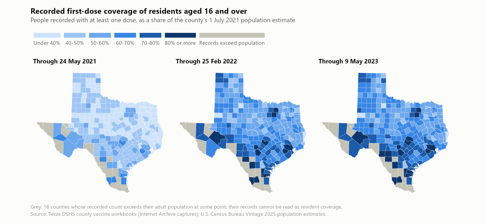

*Figure 2. Recorded 16+ first-dose coverage at the baseline, at the end of the near-monthly intervals, and at the end
of the study.*

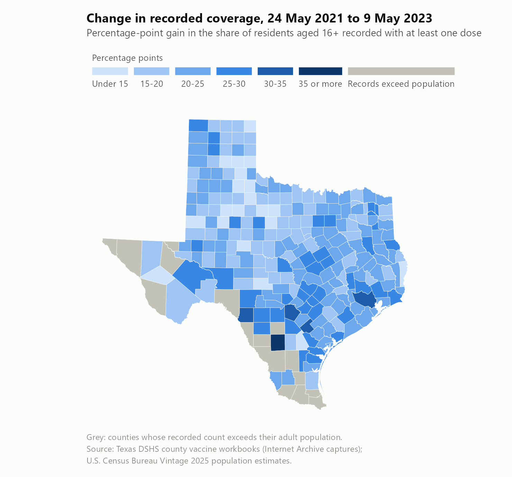

*Figure 3. Percentage-point change in recorded coverage over the study.*

Recorded first doses, coverage and uptake by interval:

| Interval | Records | Days | New first doses, all counties | Coverage at end, all counties (%) | Uptake per 30 days, all counties (%) | Coverage at end, 238 counties (%) | Uptake per 30 days, 238 counties (%) |
|---|---|---|---|---|---|---|---|
| 1 | 25 May 2021 - 22 Jun 2021 | 29 | 949,237 | 56.59 | 8.95 | 54.85 | 8.38 |
| 2 | 23 Jun 2021 - 21 Jul 2021 | 29 | 642,359 | 59.38 | 6.63 | 57.48 | 6.02 |
| 3 | 22 Jul 2021 - 21 Aug 2021 | 31 | 1,288,098 | 64.97 | 13.34 | 62.99 | 12.56 |
| 4 | 22 Aug 2021 - 23 Sep 2021 | 33 | 912,048 | 68.92 | 10.32 | 66.92 | 9.70 |
| 5 | 24 Sep 2021 - 25 Oct 2021 | 32 | 436,759 | 70.82 | 5.73 | 68.77 | 5.25 |
| 6 | 26 Oct 2021 - 20 Nov 2021 | 26 | 363,638 | 72.40 | 6.21 | 70.20 | 5.26 |
| 7 | 21 Nov 2021 - 21 Dec 2021 | 31 | 418,625 | 74.21 | 6.37 | 71.78 | 5.14 |
| 8 | 22 Dec 2021 - 21 Jan 2022 | 31 | 417,417 | 76.02 | 6.80 | 73.35 | 5.37 |
| 9 | 22 Jan 2022 - 25 Feb 2022 | 35 | 270,529 | 77.20 | 4.21 | 74.18 | 2.69 |
| 10 | 26 Feb 2022 - 30 May 2022 | 94 | 400,641 | 78.93 | 2.50 | 75.25 | 1.34 |
| 11 | 31 May 2022 - 20 Nov 2022 | 174 | 490,828 | 81.06 | 1.82 | 76.61 | 0.97 |
| 12 | 21 Nov 2022 - 09 May 2023 | 170 | 284,085 | 82.30 | 1.18 | 77.22 | 0.46 |

Coverage rose fastest between 22 July and 23 September 2021, during the Delta wave, when 12.6% and then 9.7% of
still-unvaccinated adults in the 238 counties were vaccinated per 30 days. From mid-2022 the rate was below 1% per
30 days.

The ten most populous counties kept in the analysis:

| County | Adults 16+ | Coverage 24 May 2021 (%) | Coverage 9 May 2023 (%) | Change (points) | Relative uptake (95% CrI) |
|---|---|---|---|---|---|
| Harris | 3,660,544 | 55.6 | 87.0 | 31.4 | 3.07 (3.05 to 3.09) |
| Dallas | 2,021,919 | 55.3 | 84.0 | 28.7 | 2.54 (2.52 to 2.56) |
| Tarrant | 1,655,595 | 50.6 | 75.7 | 25.1 | 1.67 (1.66 to 1.69) |
| Bexar | 1,587,099 | 54.4 | 89.1 | 34.7 | 3.67 (3.65 to 3.70) |
| Travis | 1,067,760 | 64.0 | 89.1 | 25.1 | 3.08 (3.06 to 3.11) |
| Collin | 866,220 | 59.7 | 83.4 | 23.8 | 2.23 (2.21 to 2.25) |
| Denton | 742,179 | 54.7 | 76.8 | 22.1 | 1.61 (1.60 to 1.63) |
| Fort Bend | 655,321 | 65.1 | 89.7 | 24.6 | 3.09 (3.06 to 3.11) |
| Williamson | 502,765 | 58.7 | 83.4 | 24.7 | 2.33 (2.31 to 2.35) |
| Montgomery | 501,882 | 47.5 | 74.6 | 27.1 | 1.79 (1.78 to 1.81) |

Largest and smallest recorded gains:

| County | Adults 16+ | Coverage 24 May 2021 (%) | Coverage 9 May 2023 (%) | Change (points) | Relative uptake (95% CrI) |
|---|---|---|---|---|---|
| La Salle | 5,406 | 59.8 | 96.8 | 37.0 | 4.72 (4.29 to 5.21) |
| Bexar | 1,587,099 | 54.4 | 89.1 | 34.7 | 3.67 (3.65 to 3.70) |
| Kinney | 2,599 | 47.6 | 80.9 | 33.3 | 2.39 (2.21 to 2.59) |
| Harris | 3,660,544 | 55.6 | 87.0 | 31.4 | 3.07 (3.05 to 3.09) |
| Karnes | 12,207 | 49.3 | 79.5 | 30.3 | 2.23 (2.16 to 2.31) |
| Pecos | 11,836 | 55.2 | 84.8 | 29.6 | 2.47 (2.37 to 2.57) |
| Dallam | 5,189 | 48.4 | 77.5 | 29.1 | 1.84 (1.71 to 1.96) |
| Uvalde | 19,062 | 53.8 | 82.6 | 28.8 | 2.38 (2.30 to 2.46) |
| Caldwell | 36,809 | 43.7 | 72.5 | 28.8 | 1.60 (1.56 to 1.64) |
| Dallas | 2,021,919 | 55.3 | 84.0 | 28.7 | 2.54 (2.52 to 2.56) |

| County | Adults 16+ | Coverage 24 May 2021 (%) | Coverage 9 May 2023 (%) | Change (points) | Relative uptake (95% CrI) |
|---|---|---|---|---|---|
| Jeff Davis | 1,754 | 62.2 | 71.2 | 9.0 | 0.73 (0.63 to 0.85) |
| Throckmorton | 1,216 | 44.2 | 55.0 | 10.9 | 0.43 (0.35 to 0.51) |
| King | 198 | 18.7 | 29.8 | 11.1 | 0.44 (0.31 to 0.62) |
| Lipscomb | 2,317 | 34.2 | 45.6 | 11.4 | 0.44 (0.38 to 0.50) |
| Cottle | 1,123 | 39.4 | 51.2 | 11.8 | 0.48 (0.40 to 0.58) |
| Newton | 10,029 | 24.3 | 36.4 | 12.1 | 0.30 (0.27 to 0.32) |
| Motley | 873 | 40.9 | 53.0 | 12.1 | 0.50 (0.40 to 0.61) |
| Borden | 493 | 31.6 | 43.8 | 12.2 | 0.40 (0.30 to 0.52) |
| Donley | 2,771 | 36.8 | 49.4 | 12.6 | 0.46 (0.41 to 0.52) |
| Gaines | 15,021 | 21.2 | 34.1 | 12.9 | 0.36 (0.33 to 0.38) |

La Salle County's recorded coverage (96.8%) is close to the ceiling and it borders flagged counties; its gain should
be read with the caution in section 3.4. The full county table is
[outputs/tables/county_results.csv](../outputs/tables/county_results.csv).

### 3.3 Did the gaps between counties widen or narrow?

They widened (Figure 4, upper panel).

| Records through | 10th percentile | 25th | Median | 75th | 90th percentile | Gap 90th - 10th (points) | Standard deviation | Pooled coverage |
|---|---|---|---|---|---|---|---|---|
| 24 May 2021 | 32.23 | 36.33 | 41.27 | 47.25 | 53.95 | 21.73 | 8.42 | 50.86 |
| 23 Sep 2021 | 44.68 | 48.45 | 54.49 | 61.36 | 67.56 | 22.87 | 9.68 | 66.92 |
| 25 Feb 2022 | 49.86 | 54.46 | 60.21 | 67.89 | 74.23 | 24.37 | 10.34 | 74.18 |
| 30 May 2022 | 50.68 | 55.14 | 61.02 | 68.65 | 75.29 | 24.60 | 10.47 | 75.25 |
| 09 May 2023 | 51.33 | 55.89 | 61.91 | 70.37 | 77.57 | 26.24 | 10.82 | 77.22 |

- The 10th percentile of county coverage rose by 19.1 points and the 90th percentile by 23.6.
- Later gains were positively related to starting coverage (Figure 4, lower panel): slope 0.18 points per point,
  correlation 0.32.
- In relative terms the divergence is larger. On 24 May 2021 the 10th-percentile county had 1.5 times the
  unvaccinated share of the 90th-percentile county (67.8% against 46.0%); on 9 May 2023 it had 2.2 times (48.7%
  against 22.4%).
- The gap had reached 24.4 points by 25 February 2022 and was 26.2 points at the end.

A widening in percentage points is not automatic. If every county vaccinated the same share of its remaining
unvaccinated adults, counties that started lower would gain more points and the gap would shrink. It grew because
uptake among the unvaccinated was itself higher where coverage was already higher (section 4.4).

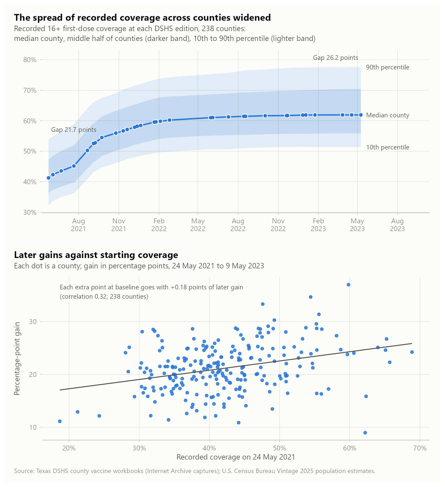

*Figure 4. Spread of recorded coverage across counties over time, and later gain against starting coverage.*

### 3.4 Counties whose records exceed their population

| County | Adults 16+ | Recorded coverage 24 May 2021 (%) | Recorded coverage 9 May 2023 (%) |
|---|---|---|---|
| Maverick | 42,158 | 73.8 | 233.8 |
| Reeves | 10,182 | 50.2 | 229.2 |
| Webb | 194,896 | 80.1 | 188.9 |
| Brooks | 5,405 | 58.0 | 184.0 |
| Dimmit | 6,387 | 73.6 | 148.5 |
| Presidio | 4,754 | 104.3 | 148.0 |
| Hidalgo | 644,648 | 67.7 | 140.3 |
| Loving | 32 | 100.0 | 137.5 |
| Hudspeth | 2,692 | 93.1 | 136.3 |
| Starr | 47,947 | 75.1 | 130.1 |
| Cameron | 317,378 | 71.0 | 126.4 |
| Frio | 13,780 | 47.1 | 123.9 |
| Val Verde | 35,905 | 60.0 | 114.2 |
| El Paso | 673,152 | 67.3 | 113.2 |
| Willacy | 16,100 | 58.9 | 104.2 |
| Duval | 7,850 | 65.9 | 101.4 |

These 16 counties hold 8.8% of Texans aged 16+ but 35% of the adult first doses recorded statewide in
January-February 2022 and 55% of those recorded between November 2022 and May 2023. Their counts keep rising long
after they pass 100% of the population estimate. Fourteen of the 16 are in South Texas or along the Rio Grande;
Reeves and Loving are in the far-west oil field. The records do not identify the recipients. A plausible reading,
which these files cannot confirm, is that people who were not usual residents (cross-border patients, people held
in custody, temporary workers) were recorded at local addresses. The counts are reported as recorded and are not
interpreted as resident coverage. Statewide figures that include these counties (the "all counties" columns of the
interval table) are inflated to an unknown degree for the same reason.

## 4. Modelled uptake

### 4.1 Model

For county *i* and interval *k* of length *d* days:

```
new first doses[i,k] ~ Binomial(adults not yet vaccinated[i,k], p[i,k])

log(-log(1 - p[i,k])) = log(d[k] / 30)
                        + intercept
                        + b_age * age[i] + b_income * income[i] + b_cases * cases[i,k]
                        + time[k]            shared time effect (random walk over interval midpoints)
                        + county[i]          county effect
                        + path[i,k]          county-specific course over time (models M2-M4)
                        + deviation[i,k]     county-interval deviation
```

The complementary log-log link with the interval length as an offset means that everything on the right-hand side
describes the rate per 30 days at which still-unvaccinated adults are vaccinated (a hazard), whatever the length of
the interval. Exponentiated coefficients are hazard ratios.

| Model | County effect | County-specific course |
|---|---|---|
| M0 | Independent across counties (no spatial structure) | none |
| M1 | BYM2: a spatially smooth part shared with neighbours plus an independent part | none |
| M2 | BYM2 | a straight-line trend per county |
| M3 | BYM2 | a random walk per county, summing to zero over time (Knorr-Held type II) |
| M4 | BYM2 | a mean-reverting process per county in continuous time (Ornstein-Uhlenbeck) |

The county-interval deviation absorbs variation beyond the binomial. Without it, counties with millions of
residents would be treated as measured without error and would dictate every estimate. Predictors are standardised.
Standard deviations have penalised-complexity priors with a 1% prior probability of exceeding 1 on the log-hazard
scale; the BYM2 mixing parameter has prior probability two-thirds of being below 0.5. The models were fitted with
R-INLA 26.08.07 (integrated nested Laplace approximation). Medians and 95% credible intervals of coefficients and
variance parameters are quantiles of R-INLA's posterior marginals; those of quantities that combine several
parameters (county rates, relative uptake, modelled change in coverage) come from 1,000 joint posterior draws.
Partial pooling enters through the county effect, the county course and the deviation:
where a county-interval has few events its estimate leans on the county's other intervals, its neighbours and its
predictors, and where it has many the estimate follows the count.

A second, cross-sectional model describes the coverage each county had reached at the baseline (binomial, logit
link, BYM2 county effect, the same age and income predictors, and cumulative reported cases before vaccination
began on 14 December 2020).

### 4.2 Which model predicts best

Four out-of-sample experiments, each refitting the model with the tested county-intervals withheld:

- **A. Counties with no data.** Ten random folds of counties; every interval of the held-out counties is predicted.
- **B. Regions with no data.** Each of the eight DSHS public health regions is held out in turn, so most of a held-out
  county's neighbours are held out with it.
- **C. Later intervals.** For a random half of the counties, every interval after an origin (21 August 2021, 20
  November 2021 or 25 February 2022) is withheld while the other half stays observed. The statewide level of the
  later intervals is then known, and the test isolates what the model knows about each county's own course.
- **D. Next interval.** Everything after an origin is withheld for all counties and the next interval is predicted,
  for nine origins. This is a true forecast.

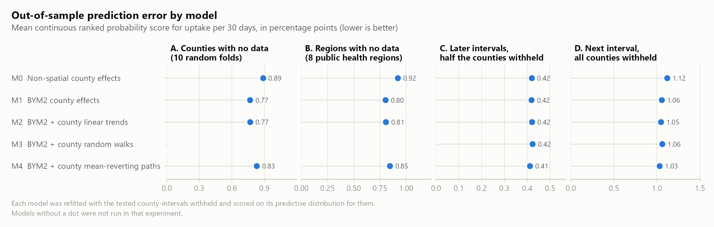

*Figure 5. Mean continuous ranked probability score by model and experiment.*

| Experiment | Model | County-intervals | Mean CRPS (points) | Mean absolute error (points) | Mean log score | 95% interval coverage | Mean 95% interval width (points) | Relative log-hazard RMSE | Relative log-hazard correlation | End coverage: counties | End coverage: mean abs. error (points) | End coverage: inside 95% interval |
|---|---|---|---|---|---|---|---|---|---|---|---|---|
| A. Counties with no data (10 random folds) | M0 | 2,855 | 0.888 | 1.173 | -6.152 | 0.930 | 7.46 | 0.542 | 0.292 | 237 | 4.59 | 0.966 |
| A. Counties with no data (10 random folds) | M1 | 2,855 | 0.768 | 1.034 | -6.003 | 0.934 | 6.40 | 0.471 | 0.557 | 237 | 3.65 | 0.966 |
| A. Counties with no data (10 random folds) | M2 | 2,855 | 0.769 | 1.035 | -5.972 | 0.936 | 6.32 | 0.470 | 0.558 | 237 | 3.65 | 0.970 |
| A. Counties with no data (10 random folds) | M4 | 2,855 | 0.829 | 1.101 | -6.028 | 0.957 | 8.09 | 0.478 | 0.549 | 237 | 4.02 | 0.987 |
| B. Regions with no data (8 public health regions) | M0 | 2,855 | 0.921 | 1.214 | -6.198 | 0.925 | 7.55 | 0.491 | 0.314 | 237 | 4.84 | 0.949 |
| B. Regions with no data (8 public health regions) | M1 | 2,855 | 0.803 | 1.075 | -6.074 | 0.930 | 6.49 | 0.479 | 0.373 | 237 | 3.88 | 0.962 |
| B. Regions with no data (8 public health regions) | M2 | 2,855 | 0.807 | 1.080 | -6.051 | 0.930 | 6.41 | 0.480 | 0.370 | 237 | 3.90 | 0.966 |
| B. Regions with no data (8 public health regions) | M4 | 2,855 | 0.845 | 1.105 | -6.086 | 0.956 | 8.10 | 0.482 | 0.370 | 237 | 4.09 | 0.992 |
| C. Later intervals, half the counties withheld | M0 | 4,281 | 0.420 | 0.559 | -5.793 | 0.874 | 2.81 | 0.491 | 0.687 | 711 | 1.23 | 0.796 |
| C. Later intervals, half the counties withheld | M1 | 4,281 | 0.419 | 0.565 | -5.782 | 0.875 | 2.77 | 0.485 | 0.694 | 711 | 1.22 | 0.789 |
| C. Later intervals, half the counties withheld | M2 | 4,281 | 0.421 | 0.572 | -5.655 | 0.896 | 2.60 | 0.499 | 0.665 | 711 | 1.24 | 0.844 |
| C. Later intervals, half the counties withheld | M3 | 4,281 | 0.423 | 0.577 | -5.609 | 0.915 | 2.70 | 0.501 | 0.665 | 711 | 1.28 | 0.890 |
| C. Later intervals, half the counties withheld | M4 | 4,281 | 0.412 | 0.558 | -5.647 | 0.906 | 2.84 | 0.486 | 0.692 | 711 | 1.20 | 0.880 |
| D. Next interval, all counties withheld | M0 | 2,141 | 1.121 | 1.514 | -6.174 | 0.937 | 10.70 | 0.430 | 0.724 |  |  |  |
| D. Next interval, all counties withheld | M1 | 2,141 | 1.058 | 1.407 | -6.152 | 0.938 | 10.41 | 0.430 | 0.724 |  |  |  |
| D. Next interval, all counties withheld | M2 | 2,141 | 1.048 | 1.399 | -6.138 | 0.944 | 10.60 | 0.423 | 0.725 |  |  |  |
| D. Next interval, all counties withheld | M3 | 2,141 | 1.063 | 1.423 | -6.165 | 0.939 | 10.63 | 0.419 | 0.734 |  |  |  |
| D. Next interval, all counties withheld | M4 | 2,141 | 1.033 | 1.368 | -6.129 | 0.950 | 10.59 | 0.421 | 0.737 |  |  |  |

The continuous ranked probability score (CRPS) measures how far the whole predictive distribution lies from what
was recorded, in percentage points of uptake per 30 days; lower is better. The log score is the log of the
probability the prediction gave to the recorded count; higher is better, and it penalises a confident miss much
more heavily than CRPS does. "Relative log-hazard correlation" is the correlation between predicted and recorded
county positions within an interval, after removing whatever error all counties share. "End coverage" is coverage
on 9 May 2023 computed from the predicted interval rates.

The statements below rest on differences between models scored on the same county-intervals. The next table gives
those differences with 95% intervals obtained by resampling whole counties (whole forecast origins in experiment
D, where every county shares the error in the statewide level, so there are only nine independent units).

| Experiment | County-intervals | Comparison | Mean CRPS (points) | Mean log score | End coverage: mean abs. error (points) |
|---|---|---|---|---|---|
| A | all scored | M1 minus M0 | -0.121 (-0.177 to -0.071) | 0.148 (0.094 to 0.203) | -0.937 (-1.364 to -0.527) |
| A | all scored | M2 minus M1 | 0.001 (-0.002 to 0.005) | 0.031 (0.020 to 0.042) | -0.002 (-0.045 to 0.038) |
| A | all scored | M4 minus M1 | 0.062 (0.041 to 0.083) | -0.024 (-0.048 to 0.000) | 0.368 (0.194 to 0.533) |
| B | all scored | M1 minus M0 | -0.117 (-0.170 to -0.070) | 0.124 (0.069 to 0.179) | -0.962 (-1.432 to -0.501) |
| B | all scored | M4 minus M1 | 0.042 (0.027 to 0.056) | -0.011 (-0.034 to 0.013) | 0.209 (0.080 to 0.335) |
| C | all scored | M1 minus M0 | -0.001 (-0.007 to 0.005) | 0.011 (-0.003 to 0.025) | -0.007 (-0.040 to 0.025) |
| C | all scored | M3 minus M1 | 0.004 (-0.005 to 0.013) | 0.172 (0.100 to 0.250) | 0.061 (0.012 to 0.110) |
| C | all scored | M4 minus M1 | -0.007 (-0.014 to 0.000) | 0.135 (0.085 to 0.190) | -0.015 (-0.048 to 0.020) |
| C | all scored | M4 minus M3 | -0.011 (-0.017 to -0.006) | -0.037 (-0.064 to -0.012) | -0.076 (-0.104 to -0.049) |
| C | 1 interval ahead | M3 minus M1 | -0.048 (-0.066 to -0.030) | 0.067 (0.029 to 0.108) |  |
| C | 1 interval ahead | M4 minus M1 | -0.056 (-0.077 to -0.035) | 0.076 (0.038 to 0.115) |  |
| C | 1 interval ahead | M4 minus M3 | -0.008 (-0.017 to 0.000) | 0.008 (-0.003 to 0.019) |  |
| C | 2-3 ahead | M3 minus M1 | 0.005 (-0.006 to 0.015) | 0.177 (0.111 to 0.244) |  |
| C | 2-3 ahead | M4 minus M1 | -0.001 (-0.012 to 0.009) | 0.123 (0.079 to 0.168) |  |
| C | 2-3 ahead | M4 minus M3 | -0.006 (-0.012 to -0.001) | -0.054 (-0.079 to -0.030) |  |
| C | 4 or more ahead | M3 minus M1 | 0.021 (0.011 to 0.032) | 0.204 (0.104 to 0.314) |  |
| C | 4 or more ahead | M4 minus M1 | 0.006 (0.000 to 0.011) | 0.162 (0.095 to 0.239) |  |
| C | 4 or more ahead | M4 minus M3 | -0.016 (-0.023 to -0.009) | -0.042 (-0.078 to -0.007) |  |
| D | all scored | M1 minus M0 | -0.063 (-0.144 to -0.006) | 0.022 (0.006 to 0.039) |  |
| D | all scored | M4 minus M1 | -0.025 (-0.076 to 0.017) | 0.023 (0.002 to 0.050) |  |
| D | all scored | M4 minus M3 | -0.031 (-0.046 to -0.017) | 0.036 (0.016 to 0.067) |  |

**Counties with no data (A, B): spatial structure helps.** With random counties withheld, the BYM2 model's CRPS is
0.77 against 0.89 for the non-spatial model (14% lower). Its 95% predictive
intervals are narrower (6.4 against 7.5 points) and contain the recorded count as often
(93.4% against 93.0%). It predicts a withheld county's coverage on 9 May 2023 to within
3.6 points on average, against 4.6. With whole regions withheld the CRPS advantage is
13% (0.80 against 0.92), but the model then says much less about which county in
the region is ahead of which: the correlation between predicted and recorded county positions is 0.37,
against 0.56 when only scattered counties are withheld.

County-specific courses cannot help a county that has no data. A straight-line trend per county (M2) leaves the
CRPS where it was (0.77 in A, 0.81 in B). The mean-reverting course (M4) makes it
8% worse in experiment A (0.83) and 5% worse in experiment B
(0.85). M4's intervals for an unseen county are wider (8.1 points against
6.4), because part of what sets a county apart is carried by its own course, which its neighbours
cannot inform. Its CRPS stays below the non-spatial model's in both experiments (M4 minus M0:
-0.059 (-0.130 to 0.004) in A and -0.076 (-0.135 to -0.023) in B), though in A the interval for that difference reaches zero.

**Later intervals (C): county-specific courses help the next interval and the calibration, not the average error
further ahead.** Over all withheld intervals the CRPS is almost the same for every model: 0.42,
0.42, 0.42, 0.42 and 0.41 for M0 to M4. The difference is in the first
withheld interval, where M4 scores 0.67 and M3 0.68 against 0.73 for M1 (M4 is
8% lower). Further ahead the county-specific courses bring no reduction in CRPS: M4 minus M1 is
-0.001 (-0.012 to 0.009) two to three intervals ahead and 0.006 (0.000 to 0.011) four or more ahead.

What improves at every horizon is how honest the predictions are about their uncertainty. The log score is higher
for all three models with county-specific courses (M4 minus M1: 0.135 (0.085 to 0.190)). Their 95% intervals contained
the recorded count more often: 91.5% for M3, 90.6% for M4 and 89.6% for M2, against
87.5% for M1. All are below the nominal 95%, so every model is somewhat overconfident about later
intervals. The intervals for coverage on 9 May 2023 contained the recorded figure for 89% of withheld
counties with M3 and 88% with M4, against 79% with M1. The average error of that coverage
prediction is nearly the same for every model (1.2 points for M4, 1.2 for M1). Spatial
structure makes no difference in this experiment (M1 minus M0: -0.001 (-0.007 to 0.005) points of CRPS), because a
county's own history is more informative than its neighbours.

M3 and M4 are close. M4 has the lower CRPS (M4 minus M3: -0.011 (-0.017 to -0.006)) and M3 the higher log score
(-0.037 (-0.064 to -0.012)), which comes from intervals two or more steps ahead; for the next interval the two are
indistinguishable.

**Next interval (D): no model forecasts the statewide level.** CRPS is 1.12, 1.06,
1.05, 1.06 and 1.03 for M0 to M4, well above the one-interval-ahead error in
experiment C (0.67 for M4), where the statewide level was known. Most of the excess comes from three of
the nine forecasts, in which every model predicted too much uptake:

| Interval forecast | Pooled recorded uptake in the interval before (%) | Pooled recorded uptake in this interval (%) | M0 | M1 | M2 | M3 | M4 |
|---|---|---|---|---|---|---|---|
| 22 Aug 2021 - 23 Sep 2021 | 12.56 | 9.70 | 2.82 | 1.83 | 1.91 | 1.85 | 1.65 |
| 24 Sep 2021 - 25 Oct 2021 | 9.70 | 5.25 | 4.91 | 4.68 | 4.45 | 4.56 | 4.53 |
| 26 Oct 2021 - 20 Nov 2021 | 5.25 | 5.26 | -0.46 | -0.30 | -0.30 | -0.34 | -0.25 |
| 21 Nov 2021 - 21 Dec 2021 | 5.26 | 5.14 | -0.23 | -0.15 | -0.11 | -0.08 | -0.02 |
| 22 Dec 2021 - 21 Jan 2022 | 5.14 | 5.37 | -0.04 | -0.05 | 0.00 | -0.03 | -0.07 |
| 22 Jan 2022 - 25 Feb 2022 | 5.37 | 2.69 | 1.56 | 1.51 | 1.61 | 1.65 | 1.63 |
| 26 Feb 2022 - 30 May 2022 | 2.69 | 1.34 | 0.68 | 0.73 | 0.65 | 0.80 | 0.70 |
| 31 May 2022 - 20 Nov 2022 | 1.34 | 0.97 | 0.06 | 0.08 | 0.08 | 0.11 | 0.06 |
| 21 Nov 2022 - 09 May 2023 | 0.97 | 0.46 | 0.23 | 0.22 | 0.31 | 0.30 | 0.22 |

The two intervals after the Delta-wave peak and the interval of the Omicron wave were forecast 1.5 to 5 points per
30 days too high. The models carry the last level forward, and nothing in them anticipates the end of a surge. The
case-rate predictor does not help here: it describes differences between counties at the same time, and during the
Omicron wave uptake halved while reported cases rose to their highest level. With only nine forecasts the
differences between models are imprecise: M4's CRPS is lower than M1's by an amount whose interval includes zero
(-0.025 (-0.076 to 0.017)) and lower than M3's (-0.031 (-0.046 to -0.017)). The
models still place counties correctly relative to one another: the correlation between predicted and recorded
county positions in the next interval is 0.74 for M4 and 0.72 for M0.

**Which model is used for what.** No model is best at everything.

- **M4 is used for modelled uptake** (sections 4.3 to 4.5). It has the lowest CRPS in experiment C, the
  best scores for a county's next interval, and the best leave-one-out score below. Those are the tests closest to
  what partial pooling has to do in this study: steady the estimate for a county-interval with few events by using
  the same county's other intervals. M3 is the close alternative, with better-calibrated predictions two or more
  intervals ahead and a slightly higher CRPS. M4 was preferred because it is at least as good at the nearest
  interval and each fit takes about one minute instead of about ten, which made it practical to refit it in every
  validation experiment and in the sensitivity analysis.
- **M1 is used for statements about spatial structure** (the share of variance that is spatially
  structured, the right-hand map of Figure 8) and for the neighbours-only check in section 5. It is the simplest
  of the models that do best for counties with no data (M2 matches it there), and its county effect separates
  cleanly into a smooth part and an independent part.

The choice matters little for what is reported below. County relative uptake (section 4.4) computed from M3 instead
of M4 differs by a median of 0.2% and by more than 2.0% in one county in twenty; the
largest difference is 9% (King County, 198 adults). Computed from M1, the median difference is
0.5% and the largest 11% (King County, 198 adults). The predictor associations are similar
in all five models (section 4.5). M3 was run only in experiments C and D, because of the time its fits take.

In-sample statistics separate the models poorly, because the county-interval deviation lets every model reproduce
the data it was fitted to. WAIC differs by only 35 units in about 25,700 between the best
and the worst model, and it puts M4 last. With about 1,600 effective parameters for
2,855 county-intervals WAIC is outside the range in which it is reliable, and what it measures here is
mostly how well a model would predict a repeat count for the same county-interval with its deviation known, which
every model does equally well. It is shown for completeness and was not used to choose a model. The leave-one-out
measure (mean log conditional predictive ordinate, higher is better) withholds the county-interval itself. It
puts M4 first and, like the log score in experiment C, puts the three models with county-specific courses ahead of
the two without. R-INLA flagged its leave-one-out approximation as unreliable for 44 county-intervals
under M3 and 10 under M2, against 1 under M4, so the M2 and M3 values are less secure.

| Model | WAIC | Mean log CPO | CPO values flagged | Seconds to fit |
|---|---|---|---|---|
| M0 non-spatial county effects | 25,737 | -5.971 | 0 | 4 |
| M1 BYM2 county effects | 25,732 | -5.956 | 0 | 30 |
| M2 BYM2 + county linear trends | 25,722 | -5.844 | 10 | 35 |
| M3 BYM2 + county random-walk trajectories | 25,724 | -5.853 | 44 | 583 |
| M4 BYM2 + county mean-reverting trajectories | 25,757 | -5.787 | 1 | 65 |

Variance parameters of the five models:

| Parameter (log-hazard scale) | M0 | M1 | M2 | M3 | M4 |
|---|---|---|---|---|---|
| County effect, standard deviation | 0.40 (0.36 to 0.44) | 0.37 (0.33 to 0.42) | 0.38 (0.34 to 0.43) | 0.39 (0.34 to 0.44) | 0.35 (0.28 to 0.42) |
| County effect, spatially structured share |  | 0.70 (0.49 to 0.87) | 0.69 (0.48 to 0.86) | 0.68 (0.46 to 0.85) | 0.93 (0.78 to 0.99) |
| Shared time effect, standard deviation | 0.80 (0.57 to 1.15) | 0.80 (0.56 to 1.15) | 0.80 (0.57 to 1.15) | 0.80 (0.57 to 1.15) | 0.79 (0.58 to 1.16) |
| County slope per year, standard deviation (M2) |  |  | 0.37 (0.33 to 0.42) |  |  |
| County-specific course, standard deviation (M3, M4) |  |  |  | 0.30 (0.28 to 0.33) | 0.43 (0.39 to 0.47) |
| County-specific course, mean-reversion rate per month (M4) |  |  |  |  | 0.12 (0.09 to 0.16) |
| County-interval deviation, standard deviation | 0.33 (0.32 to 0.34) | 0.33 (0.32 to 0.34) | 0.28 (0.27 to 0.29) | 0.19 (0.18 to 0.21) | 0.17 (0.15 to 0.19) |

### 4.3 Uptake over time

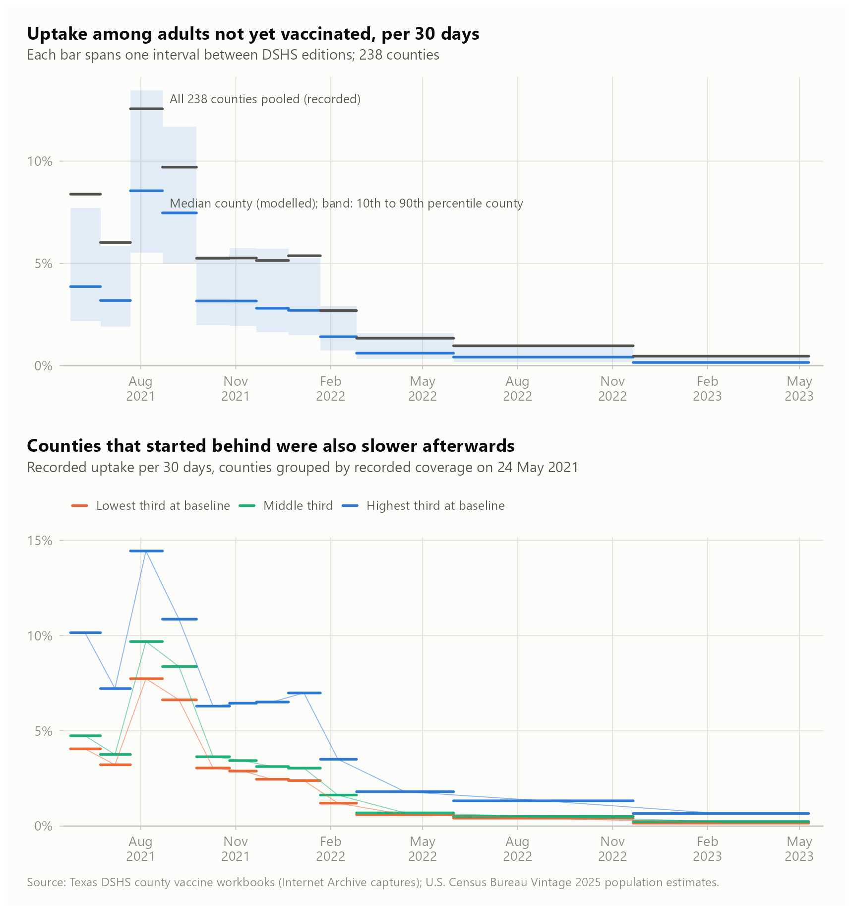

*Figure 6. Uptake per 30 days among adults not yet vaccinated: all 238 counties pooled, the median county with the
10th-90th percentile range, and counties grouped by their coverage at baseline.*

Pooled over the 238 counties, the rate fell from 8.4% per 30 days (25 May to 22 June 2021) to
6.0%, doubled to 12.6% from 22 July to 21 August 2021 as the Delta wave arrived, and eased to
9.7% and then to about 5% for the four intervals from late September 2021 to late January 2022. It was
2.7% from 22 January to 25 February 2022, 1.3% to 30 May 2022, 1.0% to 20 November
2022 and 0.5% to 9 May 2023.

The typical county was well below the pooled rate throughout. The modelled median county ran at 3.9% in the
first interval and 8.6% at the peak, when the 10th- and 90th-percentile counties were at 5.5% and
13.4%. In every interval the third of counties with the highest coverage at baseline also had the highest
uptake rate among their remaining unvaccinated adults (Figure 6, lower panel).

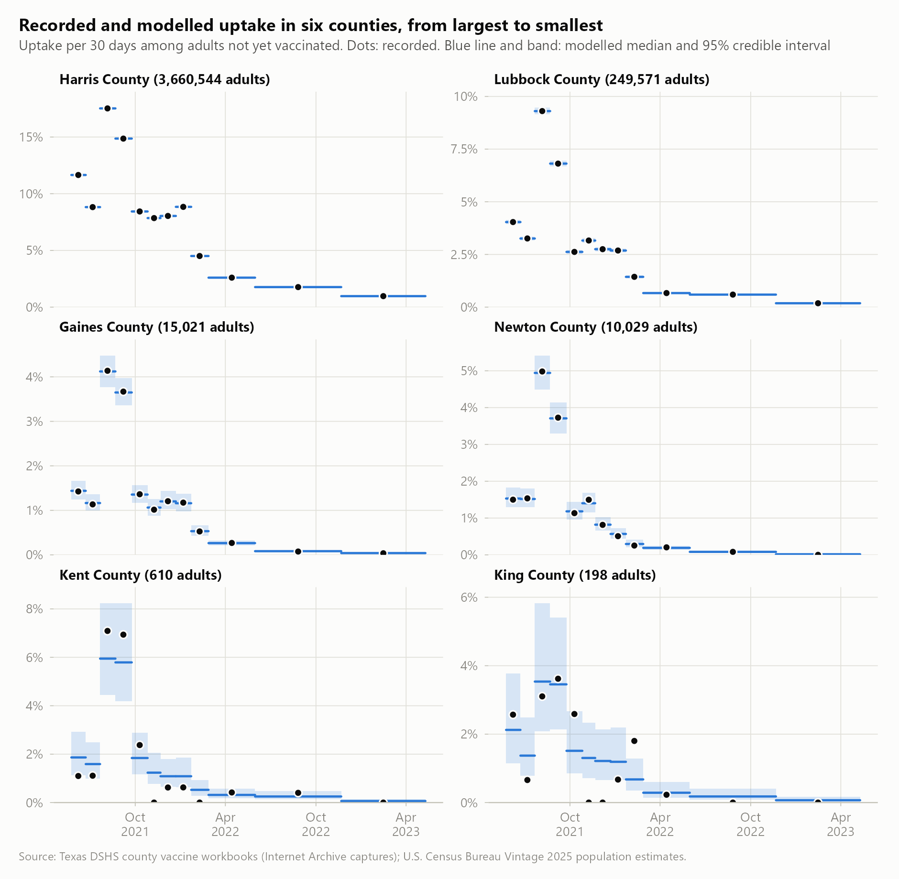

*Figure 7. Recorded and modelled uptake in six counties, with 95% credible intervals.*

Figure 7 shows what the model adds to the records. In Harris County the modelled rate equals the recorded one and
its interval is too narrow to see. In King County, with 198 adults, one first dose moves the recorded rate by more
than half a percentage point; the modelled rate follows the county's general level and its interval is wide.

### 4.4 Where uptake was higher or lower

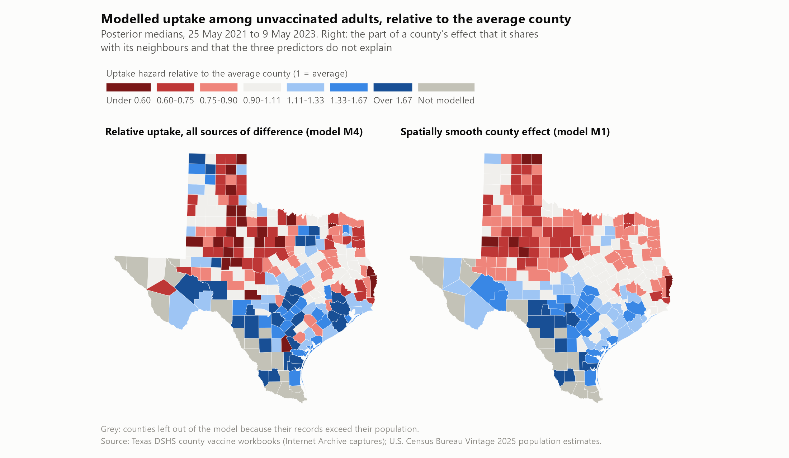

*Figure 8. Modelled uptake relative to the average county (left, model M4) and the spatially smooth part of
the county effect that the predictors do not explain (right, model M1).*

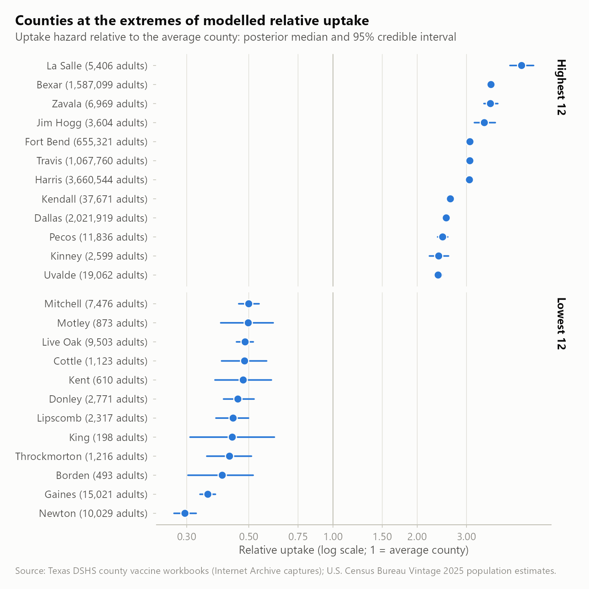

*Figure 9. The 12 highest and 12 lowest counties, with 95% credible intervals.*

Figure 8 (left) maps each county's modelled uptake rate relative to the average county, averaged over the 12
intervals. The 10th-percentile county is at 0.61 and the 90th-percentile county at 1.80, a
3.0-fold difference. For 113 of the 238 counties the 95% credible interval lies wholly
below 1 and for 93 wholly above. The six most populous counties are all above the average county
(Harris 3.1, Dallas 2.5, Tarrant 1.7, Bexar 3.7, Travis 3.1, Collin 2.2). The lowest county is Newton at 0.30 (0.27 to 0.32) and the highest La Salle at
4.72 (4.29 to 5.21). Several of the highest are small South Texas counties next to flagged ones (La Salle, Zavala, Jim
Hogg), where non-resident recipients may also be present.

Starting coverage and later uptake go together: across the 238 counties the correlation between coverage
on 24 May 2021 and modelled relative uptake afterwards is 0.73, and uptake was 1.49 times
higher per 10 points of starting coverage (95% confidence interval 1.42 to 1.56, from the scatter between
counties). This describes these counties; it is not adjusted for the three predictors.

The right-hand map shows the part of the county effect that is spatially smooth and not explained by the three
predictors. In the model without county-specific courses (M1), 70% of the between-county variance left
after the predictors is of this spatially structured kind (posterior median and 95% credible interval
0.70 (0.49 to 0.87)). The standard deviation of the county effect is 0.37 (0.33 to 0.42) on the log scale: a county at the
97.5th percentile of that effect has 4.2 times the uptake rate of one at the 2.5th percentile with
the same predictors. Coverage reached by 24 May 2021 was spatially structured to a similar or greater degree: in
the baseline model the structured share of the county effect is 0.82 (0.59 to 0.95).

Counties also drift around their own level. In M4 the county-specific course has a standard
deviation of 0.43 (0.39 to 0.47) and a half-life of 5.8 months (95% CrI 4.4 to 7.7): a county running above its usual level is,
on average, half as far above it that much later.

### 4.5 Associations with age composition, income and recent cases

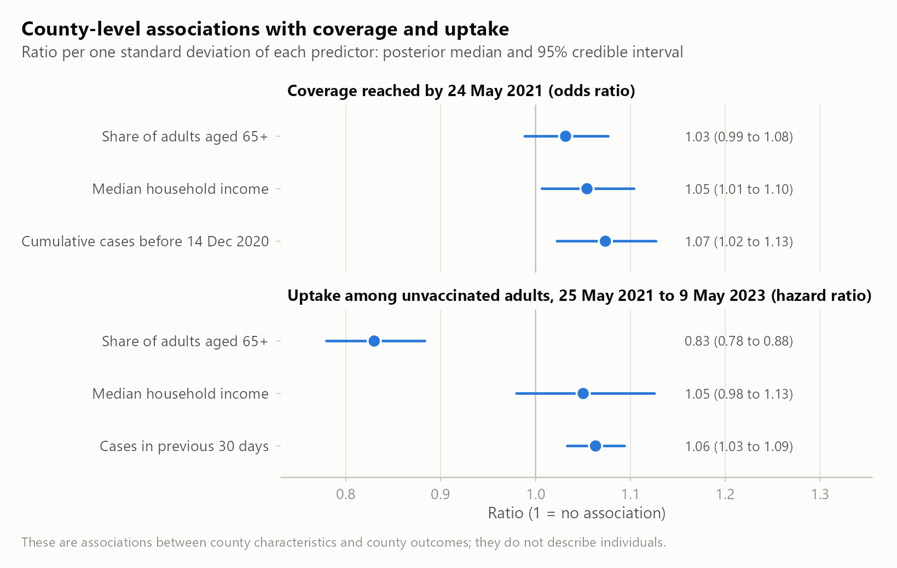

*Figure 10. County-level associations, per standard deviation of each predictor.*

| Outcome | Predictor | Contrast | Measure | Estimate |
|---|---|---|---|---|
| Uptake hazard among adults not yet vaccinated, 25 May 2021 - 9 May 2023 | Share of adults aged 65+ | per 1 SD (6.2 points) | hazard ratio | 0.83 (0.78 to 0.88) |
| Uptake hazard among adults not yet vaccinated, 25 May 2021 - 9 May 2023 | Share of adults aged 65+ | per 5 points | hazard ratio | 0.86 (0.82 to 0.90) |
| Uptake hazard among adults not yet vaccinated, 25 May 2021 - 9 May 2023 | Median household income | per 1 SD (27% higher) | hazard ratio | 1.05 (0.98 to 1.13) |
| Uptake hazard among adults not yet vaccinated, 25 May 2021 - 9 May 2023 | Median household income | per 10% higher | hazard ratio | 1.02 (0.99 to 1.05) |
| Uptake hazard among adults not yet vaccinated, 25 May 2021 - 9 May 2023 | Cases in previous 30 days | per 1 SD (4.0-fold) | hazard ratio | 1.06 (1.03 to 1.09) |
| Uptake hazard among adults not yet vaccinated, 25 May 2021 - 9 May 2023 | Cases in previous 30 days | per doubling | hazard ratio | 1.03 (1.02 to 1.05) |
| Coverage reached by 24 May 2021 | Share of adults aged 65+ | per 1 SD | odds ratio | 1.03 (0.99 to 1.08) |
| Coverage reached by 24 May 2021 | Median household income | per 1 SD | odds ratio | 1.05 (1.01 to 1.10) |
| Coverage reached by 24 May 2021 | Cumulative cases before 14 Dec 2020 | per 1 SD | odds ratio | 1.07 (1.02 to 1.13) |

- **Age composition.** One standard deviation is 6.2 points of the share of adults aged 65+. By 24 May
  2021 counties with older adult populations had, if anything, slightly higher coverage (odds ratio 1.03 (0.99 to 1.08)),
  consistent with people aged 65+ having been eligible since late December 2020. Afterwards the direction is the
  opposite: uptake among adults still unvaccinated was lower in older counties (hazard ratio 0.83 (0.78 to 0.88); per 5
  points of the 65+ share, 0.86 (0.82 to 0.90)).
- **Household income.** One standard deviation is a 27% difference in median household income.
  Higher-income counties had higher coverage at baseline (odds ratio 1.05 (1.01 to 1.10)). For later uptake the hazard
  ratio is 1.05 (0.98 to 1.13) (per 10% higher income, 1.02 (0.99 to 1.05)).
- **Recent cases.** One standard deviation is a 4.0-fold difference in cases reported in the previous
  30 days. The hazard ratio is 1.06 (1.03 to 1.09) (1.03 (1.02 to 1.05) per doubling). Because the model has a shared time
  effect, this compares counties with more and fewer reported cases at the same time; the statewide rise in uptake
  during the Delta wave is in the time effect, not in this coefficient. At baseline, counties with more cumulative
  reported cases before vaccination began had higher coverage (odds ratio 1.07 (1.02 to 1.13)).

The associations by period, from a version of M4 with separate coefficients for three periods:

| Predictor | 25 May 2021 to 23 Sep 2021 | 24 Sep 2021 to 25 Feb 2022 | 26 Feb 2022 to 09 May 2023 |
|---|---|---|---|
| Share of adults aged 65+ | 0.86 (0.80 to 0.92) | 0.83 (0.77 to 0.89) | 0.81 (0.76 to 0.87) |
| Median household income | 1.00 (0.93 to 1.08) | 1.04 (0.96 to 1.12) | 1.09 (1.01 to 1.17) |
| Cases in previous 30 days | 1.08 (1.04 to 1.13) | 1.04 (1.00 to 1.09) | 1.07 (1.00 to 1.14) |

The age association is below 1 in all three periods and somewhat stronger later. The association with recent cases
is clearest in the summer of 2021 (1.08 (1.04 to 1.13)) and weakest in the period that includes the Omicron wave
(1.04 (1.00 to 1.09)), where its interval reaches 1. Income shows no association in the first period
(1.00 (0.93 to 1.08)) and a positive one only in the last (1.09 (1.01 to 1.17)).

The choice of model changes the coefficients little (hazard ratio per standard deviation, 95% credible interval):

| Model | Share of adults aged 65+ | Median household income | Cases in previous 30 days |
|---|---|---|---|
| M0 | 0.87 (0.82 to 0.92) | 1.04 (0.98 to 1.10) | 1.09 (1.06 to 1.13) |
| M1 | 0.85 (0.81 to 0.89) | 1.02 (0.96 to 1.07) | 1.09 (1.06 to 1.12) |
| M2 | 0.85 (0.81 to 0.89) | 1.02 (0.96 to 1.07) | 1.09 (1.07 to 1.12) |
| M3 | 0.85 (0.81 to 0.89) | 1.01 (0.96 to 1.07) | 1.07 (1.04 to 1.10) |
| M4 | 0.83 (0.78 to 0.88) | 1.05 (0.98 to 1.13) | 1.06 (1.03 to 1.09) |

These are associations between county characteristics and county outcomes. Older and lower-income counties in Texas
are also more rural and differ in many unmeasured ways, so the coefficients should not be read as effects of age or
income, and they do not describe individuals.

## 5. Does smoothing hide local differences?

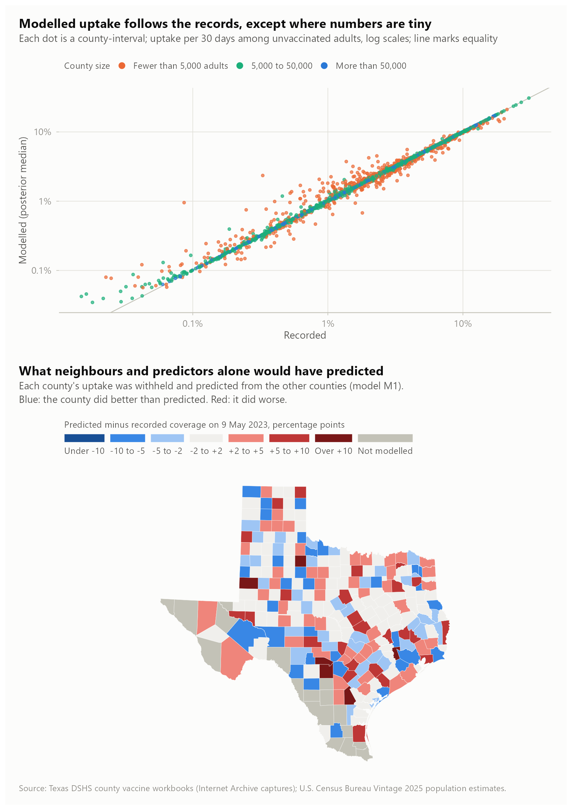

*Figure 11. Recorded against modelled uptake by county size (upper), and the error made when a county's coverage is
predicted from its neighbours and predictors alone (lower).*

For the fitted model the answer is no, because each county's estimate rests mainly on its own counts. Three checks:

1. **Modelled uptake against recorded uptake.** In counties with more than 50,000 adults the two differ by a median
   of 0.002 points per 30 days, and in counties with 5,000 to 50,000 adults by 0.02 points
   (0.8% of the recorded rate). Only below 5,000 adults does the model move the estimate noticeably:
   0.16 points, or 8% of the recorded rate (Figure 11, upper panel).

| County size | County-intervals | Counties | Median absolute difference (points per 30 days) | 95th percentile of the difference (points) | Median difference as % of the recorded rate | Recorded rate inside the modelled 95% interval (%) | Median width of the 95% interval (points) | Correlation, recorded and modelled | Correlation, recorded and modelled without the county-interval deviation |
|---|---|---|---|---|---|---|---|---|---|
| Fewer than 5,000 adults | 720 | 60 | 0.159 | 1.148 | 7.8 | 87.5 | 1.43 | 0.9846 | 0.9515 |
| 5,000 to 50,000 | 1,523 | 127 | 0.018 | 0.157 | 0.8 | 98.4 | 0.67 | 0.9996 | 0.9850 |
| More than 50,000 | 612 | 51 | 0.002 | 0.011 | 0.1 | 100.0 | 0.26 | 1.0000 | 0.9917 |

2. **Differences from neighbours survive.** For 136 of 238 counties the county effect differs
   from the mean of its neighbours' effects with at least 95% posterior probability (68 lower,
   68 higher). The counties that stand furthest from their neighbours:

| County | Adults 16+ | Ratio to neighbours (95% CrI) | Coverage 9 May 2023 (%) |
|---|---|---|---|
| Live Oak | 9,503 | 0.33 (0.29 to 0.38) | 47.0 |
| Gaines | 15,021 | 0.36 (0.31 to 0.41) | 34.1 |
| Waller | 46,936 | 0.40 (0.35 to 0.45) | 54.9 |
| Newton | 10,029 | 0.48 (0.39 to 0.57) | 36.4 |
| Kimble | 3,674 | 0.49 (0.41 to 0.57) | 56.5 |
| King | 198 | 0.49 (0.34 to 0.70) | 29.8 |
| Erath | 35,342 | 0.58 (0.50 to 0.67) | 49.5 |
| Ward | 8,341 | 0.59 (0.51 to 0.68) | 60.4 |
| Grimes | 24,304 | 1.81 (1.59 to 2.06) | 72.0 |
| Zavala | 6,969 | 1.81 (1.51 to 2.14) | 92.0 |
| Jim Wells | 29,653 | 1.82 (1.60 to 2.09) | 84.6 |
| Stonewall | 1,002 | 1.88 (1.51 to 2.34) | 64.1 |
| Bexar | 1,587,099 | 1.91 (1.64 to 2.21) | 89.1 |
| Harris | 3,660,544 | 2.01 (1.77 to 2.26) | 87.0 |
| Glasscock | 883 | 2.20 (1.75 to 2.73) | 78.4 |
| La Salle | 5,406 | 2.83 (2.36 to 3.41) | 96.8 |

3. **What smoothing alone would have done.** Experiment A predicts each county from the others without using its
   own uptake data, which is what a purely smoothed map would show. With M1, which does as well as any
   model at this task, coverage on 9 May 2023 predicted that way misses the recorded figure by a mean of
   3.6 points (median 3.0), by more than 5 points in 63 of 237 counties and
   by more than 10 points in 6 (Figure 11, lower panel). The largest miss is Live Oak (predicted 68%, recorded 47%).

So the spatial pattern is real (Moran's I of the county effects from the non-spatial model is 0.48), and
neighbours are informative, but neighbours alone would hide persistent local differences of several points of
coverage. The fitted model does not hide them. The smoothing matters only for very small counties and for the 16
counties with no usable data, for which no modelled estimate is reported.

## 6. What the credible intervals cover, and what they do not

**Recorded coverage is observed.** The registry is meant to hold every dose given to a county's residents, so
recorded coverage is a complete count rather than an estimate from a sample. It has no sampling error and is
reported without intervals. The model does not improve on it; for the cumulative change in coverage over the study
the modelled and recorded figures differ by a median of 0.03 points across counties (largest difference
3.7 points).

**What the model's intervals include:** chance variation in the number of first doses given a county's underlying
rate; uncertainty about that rate where numbers are small; uncertainty in the county, time and county-course
effects, in the predictor coefficients and in the variance parameters.

**What they leave out:**

- *Errors in the counts.* After April 2021, 1.2% to 3.0% of first-dose recipients statewide have no county. A few
  percent of each interval's doses are reported late and land in the next interval. Record corrections move small
  numbers between counties. Recipients who are not residents are counted where they were recorded. Doses given by
  federal agencies may be missing: CDC's count for Bell County (Fort Hood) is 36% above DSHS's. As a general check,
  CDC's 18+ coverage and DSHS's 16+ coverage, computed on the same population estimates, agreed closely across the
  modelled counties on 26 October 2021 (correlation 0.97, median absolute difference 1.4
  points, more than 5 points apart in 11 counties). By 9 May 2023 they agreed less well (rank
  correlation 0.93, median absolute difference 1.7 points, more than 5 points apart in
  26 counties and more than 10 in 11).
- *Errors in the population estimates.* The denominator is an estimate for one date, 1 July 2021. The numerator
  keeps people who later died or moved away and misses doses that newcomers received elsewhere, and DSHS appears to
  classify people by age at vaccination while the population ages.
- *Model form.* Other reasonable models would give somewhat different intervals.

**Why denominator error matters most where coverage is high.** The number of adults "not yet vaccinated" is the
population estimate minus the recorded count. A 3% error in the population estimate changes that number by 6% when
recorded coverage is 50%, by 12% at 75% and by 30% at 90%. Uptake rates for high-coverage counties late in the study
are therefore the least reliable numbers in this report, and county-intervals starting at 95% or more were not
modelled at all.

**Sensitivity of the main results to the choices made** (each row refits M4; hazard ratios per standard
deviation with 95% credible intervals):

| Variant | Description | Counties | County-intervals | Age 65+ share | Income | Recent cases | SD county | Spatial share (phi) | SD trajectory | SD county-interval |
|---|---|---|---|---|---|---|---|---|---|---|
| S0 | Main analysis | 238 | 2,855 | 0.83 (0.78 to 0.88) | 1.05 (0.98 to 1.13) | 1.06 (1.03 to 1.09) | 0.35 | 0.94 | 0.43 | 0.17 |
| S1 | Adds the interval 23 April - 24 May 2021 (before county re-assignments had settled) | 238 | 3,092 | 0.81 (0.76 to 0.86) | 1.04 (0.97 to 1.11) | 1.05 (1.02 to 1.09) | 0.35 | 0.92 | 0.45 | 0.22 |
| S2 | Keeps every near-monthly edition after May 2022 (18 intervals instead of 12) | 238 | 4,279 | 0.84 (0.79 to 0.89) | 1.05 (0.98 to 1.13) | 1.03 (1.00 to 1.06) | 0.40 | 0.90 | 0.47 | 0.20 |
| S3 | Denominator: the 2019 Census estimate of residents aged 16+ printed in the DSHS workbook | 242 | 2,903 | 0.77 (0.72 to 0.82) | 1.10 (1.02 to 1.18) | 1.06 (1.03 to 1.09) | 0.37 | 0.96 | 0.46 | 0.17 |
| S4 | Keeps the 16 flagged counties until their recorded coverage reaches 95% | 252 | 2,937 | 0.78 (0.73 to 0.84) | 1.01 (0.94 to 1.09) | 1.06 (1.03 to 1.09) | 0.43 | 0.96 | 0.48 | 0.16 |
| S5 | Case rate from confirmed cases only (probable cases left out) | 238 | 2,855 | 0.83 (0.78 to 0.88) | 1.05 (0.98 to 1.13) | 1.05 (1.02 to 1.08) | 0.35 | 0.93 | 0.43 | 0.17 |
| S6 | Age composition from the ACS 2019-2023 instead of the population estimates | 238 | 2,855 | 0.82 (0.77 to 0.88) | 1.05 (0.98 to 1.13) | 1.06 (1.03 to 1.09) | 0.36 | 0.94 | 0.43 | 0.17 |
| S7 | Drops the county-intervals where a fall in the recorded count was set to zero | 238 | 2,815 | 0.84 (0.80 to 0.89) | 1.05 (0.98 to 1.12) | 1.06 (1.03 to 1.09) | 0.35 | 0.92 | 0.37 | 0.18 |
| S8 | Rate per adult resident instead of per adult not yet vaccinated | 238 | 2,855 | 0.88 (0.85 to 0.92) | 1.03 (0.98 to 1.07) | 1.07 (1.04 to 1.10) | 0.19 | 0.92 | 0.34 | 0.17 |
| S9 | Also leaves out the 23 kept counties that border a flagged county | 215 | 2,580 | 0.84 (0.79 to 0.89) | 1.08 (1.00 to 1.16) | 1.05 (1.02 to 1.08) | 0.32 | 0.94 | 0.42 | 0.17 |
| S10 | Ends on 30 May 2022 (drops the two half-year intervals) | 238 | 2,380 | 0.84 (0.80 to 0.88) | 1.00 (0.95 to 1.05) | 1.08 (1.05 to 1.11) | 0.34 | 0.78 | 0.26 | 0.14 |
| S11 | Leaves out counties with fewer than 1,000 adults | 228 | 2,735 | 0.83 (0.77 to 0.88) | 1.05 (0.97 to 1.12) | 1.06 (1.03 to 1.10) | 0.35 | 0.96 | 0.43 | 0.17 |
| S12 | Same data, R-INLA classic mode with simplified Laplace approximation | 238 | 2,855 | 0.83 (0.78 to 0.88) | 1.05 (0.98 to 1.13) | 1.06 (1.03 to 1.09) | 0.35 | 0.94 | 0.43 | 0.17 |

Across the 12 alternatives the hazard ratio per standard deviation ranges from 0.77 to 0.88 for the 65+
share, 1.00 to 1.10 for income and 1.03 to 1.08 for recent cases.

- **Age composition.** The hazard ratio is below 1 in every variant. It is furthest from 1 with the 2019 denominators
  that DSHS used (S3, 0.77 (0.72 to 0.82)).
- **Recent cases.** Above 1 in every variant, and smallest when the last year is cut into finer intervals (S2,
  1.03 (1.00 to 1.06)).
- **Income.** The least stable of the three. It is 1.05 (0.98 to 1.13) in the main analysis, 1.00 (0.95 to 1.05) when the
  study ends in May 2022, 1.10 (1.02 to 1.18) with the 2019 denominators and 1.08 (1.00 to 1.16) when the kept counties that
  border flagged ones are also left out. The data do not settle whether income is associated with later uptake.
- **Flagged counties.** Keeping them until their recorded coverage reaches 95% (S4) moves the income ratio to
  1.01 (0.94 to 1.09) and raises the standard deviation of the county effect, which is what counties that do not behave
  like the rest would do.
- **Uptake per adult resident** instead of per adult not yet vaccinated (S8) gives the same directions:
  0.88 (0.85 to 0.92), 1.03 (0.98 to 1.07) and 1.07 (1.04 to 1.10).
- **The approximation.** Refitting with R-INLA's older approximation strategy (S12) gives 0.83 (0.78 to 0.88),
  1.05 (0.98 to 1.13) and 1.06 (1.03 to 1.09), the same as the main analysis.

## 7. Limitations

- **Sixteen counties and 8.8% of adults are outside the models**, including El Paso, Hidalgo, Cameron and Webb.
  Conclusions about gaps and associations are about the other 238 counties.
- **The first five months of the rollout are not modelled in this report.** They are represented by coverage on
  24 May 2021. A county series for December 2020 to May 2021 needs an assumption about where the then-unassigned
  recipients lived; [03_early_rollout.md](03_early_rollout.md) builds one, tests it and shows how little of its
  conclusions depends on it. One of its findings bears on section 4.5: the negative association with the share of
  older adults begins in April 2021, when eligibility opened to all adults.
- **Adults means 16 and over**, the youngest adult band in the records.
- **Intervals are unequal** and three are long. Month-level detail after February 2022 is not recoverable from the
  surviving files.
- **Counties with large institutions.** A prison, military base or university puts people in the population estimate
  whose vaccinations may be recorded elsewhere or by another system, which lowers recorded coverage. The records
  cannot separate this from real differences in uptake. The CDC comparison suggests it matters in places: CDC's
  count is 36% above DSHS's in Bell County (Fort Hood) and 24% above in Live Oak County, one of the counties that
  differs most from its neighbours.
- **Reported cases** changed character on 1 January 2022 (final counts before, provisional daily reports after),
  omit home tests, and reflect testing as well as infection.
- **Three predictors only.** Age composition and income are correlated with rurality, health-care access, political
  preference and ethnic composition, none of which is in the model. The coefficients describe which counties had
  higher uptake, not why.
- **Refitting does not give identical numbers.** R-INLA does not return exactly the same fit twice on the same
  computer, and the 1,000 posterior draws then come out as a different sample even though their seed is fixed. When
  the models of sections 4 and 6 and of the extension were fitted again on 24 November 2026, hazard ratios changed by
  at most 0.0006, county relative
  uptake by at most 1.1% (its interval bounds by at most 3.3%) and modelled uptake in a
  county and interval by at most 0.26 points per 30 days. The out-of-sample experiments of section 4.2
  were not run again, so the 373 values quoted from them are not part of this comparison. Of the
  other 510 values that the scripts fill into this report and the extension, 21 came
  out differently, each by at most 5 units in its last printed digit; they are listed in
  [rerun_changed_values.csv](../outputs/tables/rerun_changed_values.csv). The numbers printed here are those of one
  run, and the last digit of a modelled number should be read with that in mind. Recorded coverage and everything
  computed from it repeat exactly. The comparison is made by [R/18_rerun_check.R](../R/18_rerun_check.R).
- **Approximate inference.** R-INLA approximates the posterior. A second approximation strategy gave the same
  estimates (variant S12), but no simulation-based (MCMC) fit was run to confirm them.

## 8. Reproducing and tracing results

[README.md](../README.md) lists the commands. Every raw file is in `data/raw/` with its address and SHA-256 in
[data/raw/MANIFEST.csv](../data/raw/MANIFEST.csv). The numbers in this report's tables are produced by
[R/10_report_tables.R](../R/10_report_tables.R) from the CSV files in `outputs/tables/`; the figures and their data
by [R/08_outputs.R](../R/08_outputs.R).

| Result | File |
|---|---|
| County results (recorded coverage, change, modelled relative uptake with intervals) | [county_results.csv](../outputs/tables/county_results.csv) |
| Modelled uptake for every county and interval, with intervals | [modelled_uptake_county_interval.csv](../outputs/tables/modelled_uptake_county_interval.csv) |
| Gap measures at every edition | [fig04_gap_over_time.csv](../outputs/tables/fig04_gap_over_time.csv) |
| Model parameters | [fixed_effects.csv](../outputs/models/fixed_effects.csv), [hyperparameters.csv](../outputs/models/hyperparameters.csv) |
| Validation scores, row by row | `outputs/tables/validation_*_rows_*.csv` |
| Differences between models with bootstrap intervals | [validation_paired_differences.csv](../outputs/tables/validation_paired_differences.csv) |
| County relative uptake under each of the five models | [relative_uptake_by_model.csv](../outputs/tables/relative_uptake_by_model.csv) |
| Sensitivity analysis | [sensitivity.csv](../outputs/tables/sensitivity.csv) |
| Analysis dataset | [panel.csv](../data/derived/panel.csv) |
| Extension to December 2020 - May 2021 | [03_early_rollout.md](03_early_rollout.md) |
