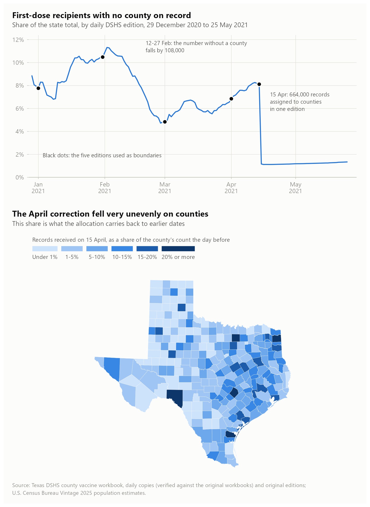
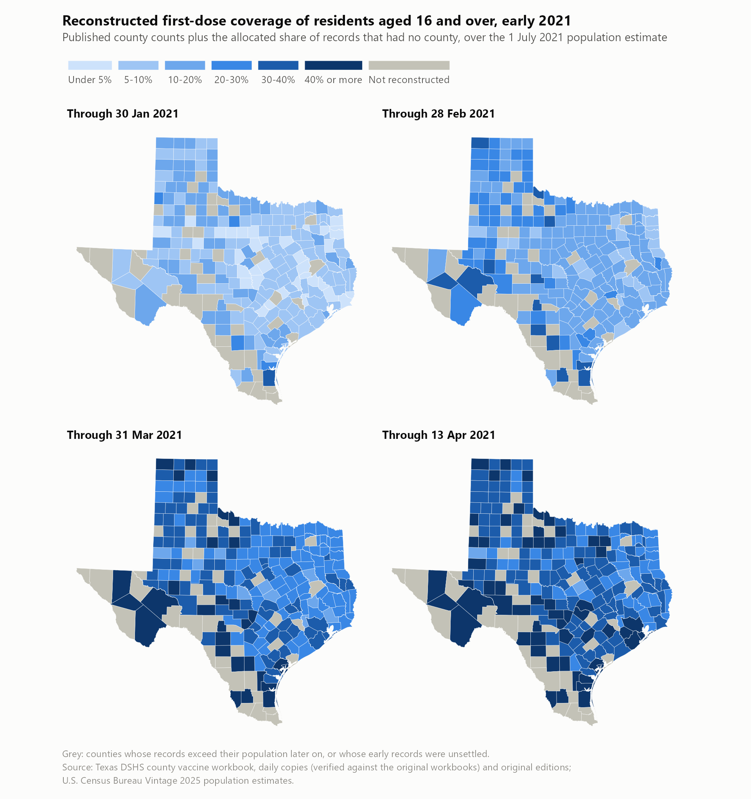
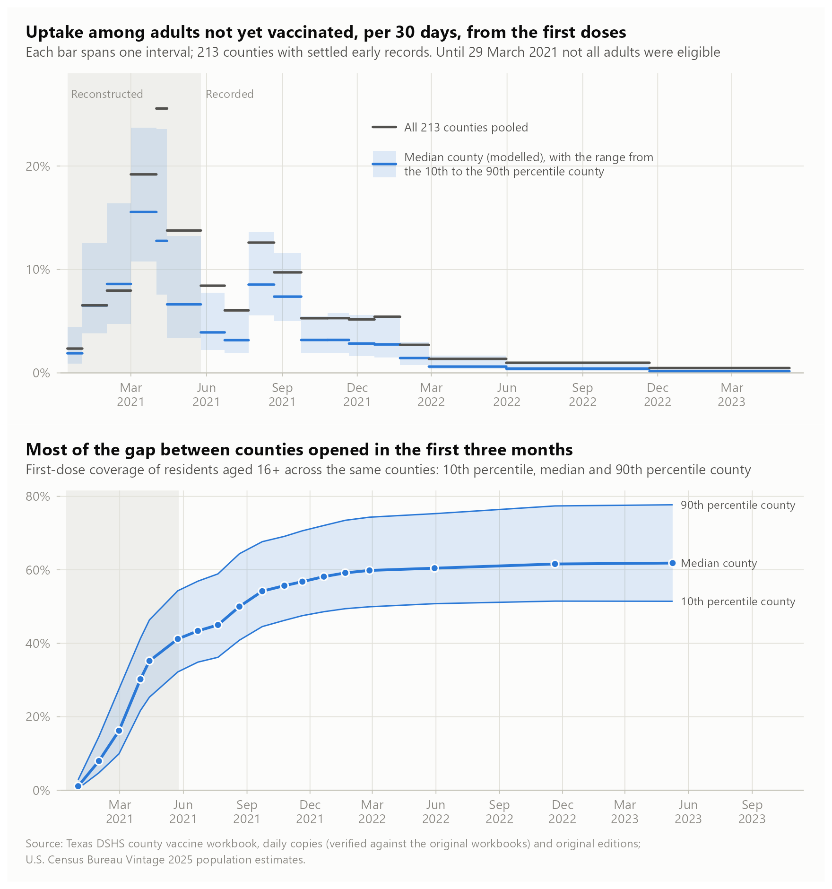
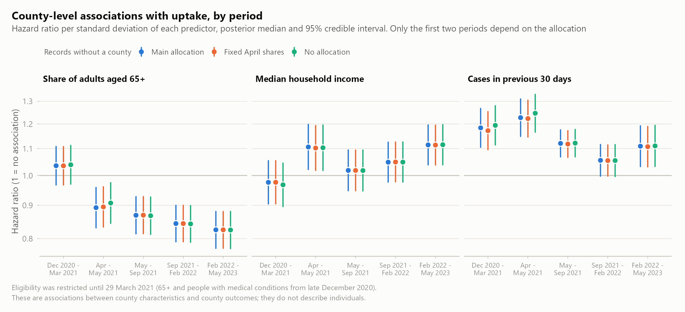
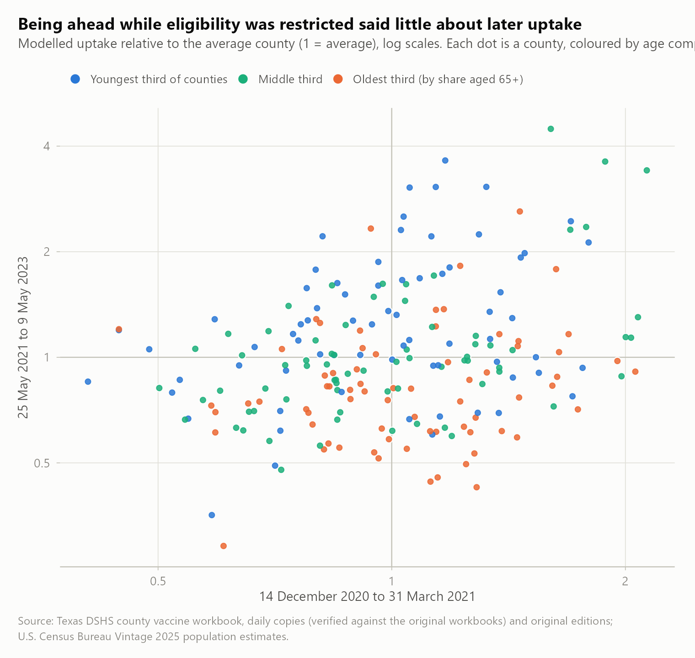

# Extension: county coverage and uptake from the first doses, 14 December 2020 to 24 May 2021

This document extends the analysis in [02_report.md](02_report.md) back to the start of the rollout. The main
report begins on 24 May 2021 because county counts before mid-April 2021 are incomplete: a share of recipients had
no county on record, and that share differed from county to county. Going further back requires an assumption
about where those recipients lived. The assumption is stated in section 3, tested as far as the files allow, and
varied in section 7. Nothing here changes the main report; its results do not depend on the assumption.

Three terms are used throughout. **Published** is a county count exactly as it stood in a DSHS edition.
**Reconstructed** is the published count plus the county's allocated share of the records that had no county at
the time. **Modelled** is a posterior summary from the model fitted to the reconstructed series. As in the main
report, every number describes vaccine receipt as recorded, not willingness.

## 1. Summary

**What was done.** Daily copies of the DSHS county sheet survive from 29 December 2020. Six intervals were added
before the main baseline: 14-31 December 2020, January, February and March 2021, 1-13 April, and 14 April-24 May.
On 15 April 2021 DSHS assigned about {{v:fix_assigned_round}} previously unassigned recipients to counties in a
single edition. How many each county received that day is observed. The assumption is that at earlier dates each county
was missing the same relative share of its recipients, scaled so that the allocations add up to the number of
unassigned recipients actually published at that date.

**What the reconstructed series shows.**

- Statewide, the share of residents aged 16+ recorded with a first dose was {{v:cov_all_k2}}% on 30 January 2021,
  {{v:cov_all_k3}}% on 28 February, {{v:cov_all_k4}}% on 31 March, {{v:cov_all_k5}}% on 13 April and
  {{v:cov_all_k6}}% on 24 May. Uptake among adults not yet vaccinated peaked at {{v:up_all_k5}}% per 30 days in
  the first two weeks of April, just after eligibility opened to all adults.
- **Most of the gap between counties opened early.** Across the {{v:n_stable}} counties with usable early records,
  the distance between the 90th- and 10th-percentile county was {{v:gap_b2}} points on 30 January, {{v:gap_b3}}
  on 28 February and {{v:gap_b6}} on 24 May 2021. By the end of February it had reached {{v:gap_share_feb}} of
  its size at the main baseline and {{v:gap_share_feb_end}} of its size at the end of the study ({{v:gap_end}}
  points on 9 May 2023). The size of the gap was set early; which counties were on which side of it was not
  (rank correlation of county coverage on 28 February with coverage on 9 May 2023: {{v:rk_end_b3}}; for
  coverage on 24 May 2021: {{v:rk_end_b6}}).
- **The age association reversed in April 2021.** While eligibility was restricted (to 31 March), counties with
  more adults aged 65+ had, if anything, slightly higher uptake (hazard ratio {{v:hr_H_age_E1}} per standard
  deviation). From 1 April to 24 May the ratio was {{v:hr_H_age_E2}}, and it stayed below 1 for the rest of the
  study.
- **Income** shows no association before April ({{v:hr_H_income_E1}}) and a positive one in April-May
  ({{v:hr_H_income_E2}}). **Recent cases** are positively associated in both early periods ({{v:hr_H_cases_E1}}
  and {{v:hr_H_cases_E2}}).
- **Who was ahead changed when eligibility opened.** The correlation between a county's relative uptake to 31
  March and its relative uptake after 24 May is {{v:pc_point_2}}. Between April-May 2021 and the period after 24
  May it is {{v:pc_point_3}}. The pattern that persisted to 2023 was set in the spring of 2021, not in the first
  three months.

**How much rests on the allocation.** Little, for these conclusions. With no allocation at all, or with a
different allocation rule, the gap between the 90th- and 10th-percentile county differs by at most
{{v:gap_maxdiff_N}} points, county ranks are almost unchanged (rank correlation at least {{v:ae_rank_min}}), and
the hazard ratios in the two early periods stay within {{v:rng_age_E1}} and {{v:rng_age_E2}} for age,
{{v:rng_income_E1}} and {{v:rng_income_E2}} for income, and {{v:rng_cases_E1}} and {{v:rng_cases_E2}} for recent
cases. What the allocation does change is the level of individual counties: by up to {{v:ae_max}} points of
coverage.

**Evidence for the assumption.** It makes a prediction that can be checked: whenever the statewide number of
unassigned recipients fell, the published counts of the counties that received most on 15 April should have grown
abnormally fast, and when it rose they should have grown abnormally slowly. Over {{v:pt_n}} two-week windows the
predicted and estimated effects have a correlation of {{v:pt_cor_w}} when counties are weighted by size and
{{v:pt_cor_u}} when they are weighted equally. The assumption is therefore well supported for the counties where
most people live and less well for small ones.

**Main cautions.** {{v:n_unstable}} of the {{v:n_kept}} modelled counties ({{v:unstable_pct_adults}} of their
adults) are left out of the early intervals because their records kept changing. Dates are dates of reporting, not
of vaccination. Until 29 March 2021 not every adult was eligible, so uptake per adult not yet vaccinated mixes
eligibility with uptake among those eligible. All county counts before the baseline come from a third-party daily
copy of the DSHS sheet, which matches the original workbooks wherever both survive.

## 2. What the early records look like

**Sources.** The original DSHS workbooks survive in the Internet Archive for only {{v:n_wayback_early}} dates
before the baseline. A third-party archive saved the "By County" sheet as a CSV file on almost every day from
{{v:first_daily}} ([inventory](01_source_inventory.md), source A2). On all 21 dates in 2020-2021 for which both
exist the two are identical in every county. The five editions used as boundaries below are all from the daily copies. As elsewhere, an edition
dated D holds records through D - 1.

**County totals are counts of adults.** Before 12 May 2021 nobody under 16 was eligible. In the eight original
workbooks from 2 March to 23 April 2021 that carry both sheets, the county total equals the sum of the 16+ age
bands in every one of the 254 counties
([early_county_total_vs_16plus.csv](../outputs/tables/early_county_total_vs_16plus.csv)).

**Records moved between "no county" and counties, and between counties, in four episodes** (Figure 12, upper
panel):

1. *12 to 27 February 2021.* The number of recipients with no county fell from {{v:feb_high}} (edition of
   {{v:feb_high_date}}) to {{v:feb_low}} (edition of {{v:feb_low_date}}) while reporting continued: at least
   {{v:feb_worked_off}} earlier records were given a county in those two weeks.
2. *24 March 2021.* County counts fell by {{v:glitch_falls}} in {{v:glitch_counties}} counties in one edition and
   came back the next day (Tarrant County: down {{v:glitch_tarrant}}, then up {{v:glitch_tarrant_back}}). This was a
   one-day fault, not a correction, and no boundary is placed on it.
3. *15 April 2021.* The number with no county fell by {{v:fix_other_fall}} in one edition, from
   {{v:other_pct_b5}} of the state total to {{v:resid_pct}}.
4. *16 April to 10 May 2021.* Records kept moving between counties: falls in county counts sum to
   {{v:flux_falls}} persons across {{v:flux_counties}} counties. After the edition of 11 May the falls are
   negligible ({{v:late_falls}} persons in the two weeks to the baseline).

One daily edition (12 March 2021) has the "at least one dose" and "fully vaccinated" columns interchanged and is
not used.



*Figure 12. Recipients with no county on record over time (upper), and the share each county received in the April
correction (lower).*

**Intervals.** Boundaries were placed at month ends where a daily edition exists, and on the last edition before
the correction. No edition survives for 1 February 2021, so January ends on the 30th. The interval from 14 April
to 24 May spans the weeks in which records were still moving between counties, so that those movements cancel
within it.

{{TABLE:Reconstructed first doses, coverage and uptake by early interval}}

## 3. The allocation

**What is observed.** For each county, the number of records it received on 15 April: its rise in that edition
minus its share of that day's new first doses (estimated from its share of the following week's increase).
Together these sum to {{v:fix_assigned}}: the fall of {{v:fix_other_fall}} in the number with no county, plus
about {{v:fix_new_unassigned}} of that day's new recipients who had none. Divided by the count published for the
county the day before, this
gives the share the county had been missing: {{v:odds_agg}} over all counties, but {{v:odds_harris}} in Harris
County, {{v:odds_tarrant}} in Tarrant and {{v:odds_denton}} in Denton. Across the {{v:n_stable}} counties the
median is {{v:odds_median}}, the 90th percentile {{v:odds_p90}} and the largest {{v:odds_max}}
({{v:odds_max_county}}). In {{v:n_neg_R}} counties the estimate is slightly negative and is set to zero.

{{TABLE:Counties that received the most records on 15 April 2021}}

After the correction {{v:resid_pct}} of the state total still had no county. That share is taken to be
unassignable at every earlier date too.

**What is assumed.** For county *i* at an earlier edition *t*:

```
allocated[i,t] = U[t] * ( published[i,t] * share[i] ) / sum over counties( published[j,t] * share[j] )

U[t]      = no_county[t] - 0.0116 * state_total[t]      records that would later be given a county
share[i]  = records county i received on 15 April / its published count on 14 April
```

In words: at every earlier date each county is missing the same relative share of its recipients as the April
correction revealed, and all the shares are scaled by a common factor *u* so that the allocations add up to the
unassigned total actually published at that date. The scaling matters, because the unassigned total did not move
in step with the county counts: *u* is {{v:u_b1}} at the end of December, {{v:u_b2}} at the end of January,
{{v:u_b3}} at the end of February and {{v:u_b4}} at the end of March. On 14 April *u* is 1 and nothing is
assumed: the allocation is what DSHS did the next day.

{{TABLE:Records without a county and the amount allocated, by boundary edition}}

{{TABLE:Published and reconstructed coverage in six counties (%)}}

**Two alternatives are carried through every result.** Allocation A spreads the same total by each county's
fixed share of the April assignment, whatever its published count at the time. Allocation N allocates nothing and
uses the counts as published.

**A test of the assumption.** If county *i* is missing the share *u × share[i]* of its recipients, then between
two dates its published count grows faster or slower than its true count by about (*u* at the first date minus
*u* at the second) × *share[i]*. A regression of the growth of published counts on *share[i]* should therefore
have a slope close to that difference: positive when unassigned records were being worked off, negative when they
were piling up.

{{TABLE:Test of the allocation: growth of published county counts against the share received in April}}

In the window of the February work-off the predicted slope is {{v:pt_feb_pred}} and the estimate
{{v:pt_feb_est}}: the counties that gained most on 15 April are the same ones whose counts jumped in February.
Over the {{v:pt_n}} windows the correlation between predicted and estimated slopes is {{v:pt_cor_w}} with counties
weighted by size. With every county given equal weight it is {{v:pt_cor_u}}, and the estimates are positive in
the last three windows where the assumption predicts zero or negative values. The assumption describes the large
counties well. For small counties it is weaker, and something else that is related to the April share was also
raising their published growth in March and April.

**Counties left out.** A county's early records are treated as unsettled if (a) the falls in its count between
16 April and 11 May exceed {{v:threshold}}% of its count on 15 April, or (b) more than {{v:threshold}}% of its
count at a boundary edition was later taken away again, which happens when a batch of records is credited to the
wrong county for some days. {{v:n_unstable}} of the {{v:n_kept}} modelled counties meet one of these conditions.
Their early intervals do not enter the model or the summaries below; their intervals after 24 May are used as in
the main report. The file of modelled early uptake marks these county-intervals, whose modelled values rest on
the county's later intervals, its neighbours and its predictors rather than on its own early counts.

{{TABLE:Counties whose early records were unsettled (left out of the early intervals)}}

## 4. Eligibility

{{TABLE:Eligibility for vaccination in Texas}}

The population estimates are DSHS's own, printed in the county sheet. Until 29 March 2021 the adults "not yet
vaccinated" in a county include many who could not yet be vaccinated: by DSHS's estimates Phases 1A and 1B
together covered at most {{v:elig_1b_pct}} of adults statewide, and between {{v:elig_1b_min}} and
{{v:elig_1b_max}} across counties (median {{v:elig_1b_med}}). Uptake per adult not yet vaccinated in December to
March therefore reflects who was eligible and how much vaccine reached the county, as well as uptake among those
eligible. Section 7 includes a variant in which, for January and February, the population at risk is the
population DSHS estimated to be eligible.

## 5. Reconstructed coverage and uptake



*Figure 13. Reconstructed first-dose coverage of residents aged 16+ at four dates in early 2021.*



*Figure 14. Uptake per 30 days over the whole series (upper), and the spread of coverage across counties (lower).*

Pooled over the {{v:n_stable}} counties, {{v:up_st_k2}}% of adults not yet vaccinated received a first dose per 30
days in January 2021, {{v:up_st_k3}}% in February, {{v:up_st_k4}}% in March and {{v:up_st_k5}}% in the first 13
days of April. From 14 April to 24 May the rate was {{v:up_st_k6}}%. These are rates of reporting. The main report
(section 3.1) gives the statewide series by date of vaccination, which runs a few weeks ahead: what had been
reported by the end of a month in early 2021 was 0.8 to 3.5 points of coverage below what was eventually
attributed to that month.

{{TABLE:Coverage across counties with settled early records, from the first doses to the end of the study}}

{{TABLE:Rank correlation of county coverage at early dates with coverage later}}

The gap between the 90th- and 10th-percentile county was {{v:gap_b2}} points on 30 January 2021, {{v:gap_b3}} on
28 February, {{v:gap_b4}} on 31 March and {{v:gap_b6}} at the main baseline. In relative terms the counties were
furthest apart at the start: the 90th-percentile county had {{v:ratio_b2}} times the coverage of the
10th-percentile county at the end of January, {{v:ratio_b4}} times at the end of March and {{v:ratio_b6}} times on
24 May. The widening after May 2021 described in the main report added {{v:gap_added_later}} points to a gap that
was already {{v:gap_b6}} points wide. The ranking of counties settled later than the size of the gap: county
coverage at the end of February has a rank correlation of {{v:rk_end_b3}} with coverage at the end of the study,
coverage on 13 April {{v:rk_end_b5}}, and coverage on 24 May 2021 {{v:rk_end_b6}}.

## 6. Modelled uptake and associations by period

The model is the one selected in the main report ({{v:final}}), fitted to all 18 intervals at once:
{{v:n_ci}} county-intervals, of which {{v:n_ci_early}} are early ones. Each predictor's coefficient is allowed to
differ between five periods: 14 December 2020 to 31 March 2021, when eligibility was restricted; 1 April to 24 May
2021; and the three periods of the main report. Where a county-interval has many events the modelled rate equals
the reconstructed one (median absolute difference {{v:mod_vs_rec_med}} points per 30 days over the early
county-intervals, {{v:mod_vs_rec_small}} in counties with fewer than 5,000 adults).



*Figure 15. County-level associations by period, under the three allocations.*

{{TABLE:Hazard ratios per standard deviation by period, extended series}}

- **Age composition.** In the restricted period the hazard ratio per standard deviation of the 65+ share is
  {{v:hr_H_age_E1}}: older counties were not behind, and may have been slightly ahead, when most of those eligible
  were aged 65 and over. From April 2021 the ratio is {{v:hr_H_age_E2}} and it declines a little further in each
  later period. The negative association reported in the main report therefore starts when eligibility opens to
  all adults.
- **Household income.** No association in the restricted period ({{v:hr_H_income_E1}}); a positive one in
  April-May 2021 ({{v:hr_H_income_E2}}), which matches the main report's finding that higher-income counties had
  higher coverage by 24 May 2021.
- **Recent cases.** Positive in both early periods ({{v:hr_H_cases_E1}} and {{v:hr_H_cases_E2}}) and larger than
  later. As in the main report, the coefficient compares counties with more and fewer reported cases within the
  same interval; the statewide fall in cases after the winter wave is in the shared time effect.
- **The later periods change little when the early data are added.** Their hazard ratios differ from the main
  report's own period estimates by at most {{v:later_maxdiff}}, well inside the credible intervals (both are in
  the variant table of section 7).

**Relative uptake by period.** A county's modelled uptake relative to the average county, averaged over the
intervals of a period, ranges from {{v:rel_p10_early_restricted}} (10th percentile) to
{{v:rel_p90_early_restricted}} (90th) in the restricted period, {{v:rel_p10_spring_2021}} to
{{v:rel_p90_spring_2021}} in April-May 2021, and {{v:rel_p10_later}} to {{v:rel_p90_later}} after 24 May.

{{TABLE:Correlation of county relative uptake between periods}}



*Figure 16. County relative uptake in the restricted period against relative uptake after 24 May 2021.*

A county's position in the first three and a half months says little about its position later (correlation
{{v:pc_point_2}}), while its position in April-May 2021 says a great deal ({{v:pc_point_3}}). The intervals in the
table reflect only the uncertainty in the modelled county rates, which is small; they do not say how different
the correlation might be in another set of counties. Age composition is part of the reason:

{{TABLE:Relative uptake by period and age composition (median county in each third)}}

The oldest third of counties ran level with the youngest third while eligibility was restricted and well below it
from April 2021 on.

## 7. How much depends on the allocation

{{TABLE:Hazard ratios per standard deviation by period under each variant}}

- **Other allocation rules (A, N).** The hazard ratios of the two early periods move in the second decimal place.
  The later periods cannot move, because their data do not depend on the allocation; their small differences
  between variants come from refitting the shared parts of the model.
- **Keeping the {{v:n_unstable}} counties with unsettled records** changes the early ratios to
  {{v:hr_HU_age_E1}}, {{v:hr_HU_income_E1}} and {{v:hr_HU_cases_E1}} (restricted period) and {{v:hr_HU_age_E2}},
  {{v:hr_HU_income_E2}} and {{v:hr_HU_cases_E2}} (April-May).
- **Eligible population at risk in January and February.** With DSHS's Phase 1A and 1B population as the
  population at risk in those two months, the ratios of the restricted period are {{v:hr_HE_age_E1}} for age,
  {{v:hr_HE_income_E1}} for income and {{v:hr_HE_cases_E1}} for recent cases. Counties with more adults aged 65+
  have more eligible people, so part of what the all-adult denominator attributes to age is eligibility.

{{TABLE:Gap between the 90th and 10th percentile county under each allocation (points)}}

{{TABLE:How much the allocation changes a county's coverage}}

The allocation raises a county's count by a median of {{v:ae_uplift_med}} depending on the date, and by up to
{{v:ae_uplift_max}}. It moves county coverage by a median of at most {{v:ae_med_max}} points and by as much as
{{v:ae_max}} points in the most affected county. It does not change which counties are ahead: the rank
correlation between reconstructed and published coverage is {{v:ae_rank_min}} or higher at every date.

{{TABLE:Correlation between periods from the reconstructed counts themselves, by allocation (counties with 5,000 or more adults)}}

The weak link between the restricted period and later periods is not produced by the allocation: it is as weak
with no allocation at all.

## 8. Limitations

- **The allocation is an assumption.** It is observed on one date and carried back. Even on that date each
  county's share is an estimate: its rise in one edition, less an estimate of that day's new first doses. The test in section 3 supports
  it for large counties and less for small ones. A county whose missing share changed over the winter in a way
  that differed from the statewide pattern is misallocated, and such errors move first doses between adjacent
  intervals of that county.
- **{{v:n_unstable}} counties are left out of the early intervals**, in addition to the 16 that are left out of
  every model. The rule that selects them looks only at falls in counts. A batch of earlier vaccinations credited
  to a county for the first time after 15 April shows up as a rise and cannot be told apart from new
  vaccinations.
- **Dates are reporting dates.** Early in the rollout reporting lagged vaccination by days to weeks, and the lag
  may have differed between counties.
- **Eligibility.** Before 29 March 2021 the population at risk includes people who were not eligible. The
  eligible-population variant uses DSHS estimates whose groups overlap and is limited to January and February.
- **Third-party copies.** Every county count before the baseline comes from the daily copies. They are identical
  to the original workbooks on all 21 dates where both exist, but the other dates cannot be checked against an
  original.
- **Unequal intervals.** The April boundary falls on the 13th because of the correction, so "April" is split, and
  the interval that follows is 41 days long.
- **No separate validation exercise.** The out-of-sample experiments of the main report were not repeated for
  the early intervals.
- **Refitting does not give identical numbers.** Modelled numbers repeat closely but not exactly when the models
  are fitted again. [Section 7 of the main report](02_report.md) gives the sizes of the differences.

## 9. Files and reproduction

```
Rscript --vanilla R/13_early_reconstruction.R   # allocation, checks, extended datasets
Rscript --vanilla R/14_early_models.R           # model on the extended series, five variants
Rscript --vanilla R/15_early_outputs.R          # tables, figures 12-16 and this document
```

| Result | File |
|---|---|
| Per county: records received on 15 April, share, stability flags, DSHS phase populations | [early_county_allocation.csv](../data/derived/early_county_allocation.csv) |
| Per county and boundary: published, allocated and reconstructed counts and coverage, three allocations | [early_reconstruction.csv](../data/derived/early_reconstruction.csv) |
| Extended analysis datasets (18 intervals), one per allocation | `data/derived/panel_ext_H.csv`, `panel_ext_A.csv`, `panel_ext_N.csv` |
| Allocation by date, test of the assumption, boundary checks | [early_allocation_by_date.csv](../outputs/tables/early_allocation_by_date.csv), [early_persistence_test.csv](../outputs/tables/early_persistence_test.csv), [early_boundary_checks.csv](../outputs/tables/early_boundary_checks.csv) |
| Hazard ratios by period and variant | [early_period_associations.csv](../outputs/tables/early_period_associations.csv) |
| Modelled uptake for every county and early interval, with intervals | [early_modelled_uptake.csv](../outputs/tables/early_modelled_uptake.csv) |
| County relative uptake by period | [early_relative_uptake_by_period.csv](../outputs/tables/early_relative_uptake_by_period.csv) |
| DSHS news releases on eligibility (archived copies) | `data/raw/dshs_news/` |
